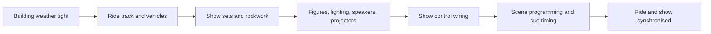

Show install is the stage where the building stops being a shell. The order is roughly fixed by access: the ride system goes in first because track and vehicles are the biggest and heaviest things in the room, then show sets and rockwork, then figures, lights, speakers and projectors, then the control wiring that links them. Scenic contractors such as Scenario prefabricate sets off site so install is bolting rather than building. Timing is tight; Hagrid's figures were still arriving in April and May 2019 for a June opening.

Programming follows. Each animated figure is given its moves on an animator's console, a lineage running from Disney's tone-on-tape triggers through the DACS system that drove a thousand channels in the early 1980s to today's digital controllers. Lighting designers set looks and fades, audio engineers tune each zone, media servers are aligned to screens. All of it is tied to the vehicle's position so that a figure turns its head when a car, not a clock, says so. That dependency is [ride and show synchronisation](../show-technology/ride-show-synchronization.md), managed by the [show control system](../show-technology/show-control-systems.md). [Figure programming](../show-technology/figure-programming.md), [theatrical lighting](../show-technology/theatrical-lighting.md) and [projection mapping](../show-technology/projection-mapping.md) each take weeks of night shifts in a dark building.

## Explore further
- `wikipedia-audio-animatronics` — Audio-Animatronics (Wikipedia)
- `wikipedia-hagrids-motorbike-adventure` — Hagrid's Magical Creatures Motorbike Adventure (Wikipedia)
- `blooloop-scenario-rebrand` — Becoming Scenario: more than rockwork
