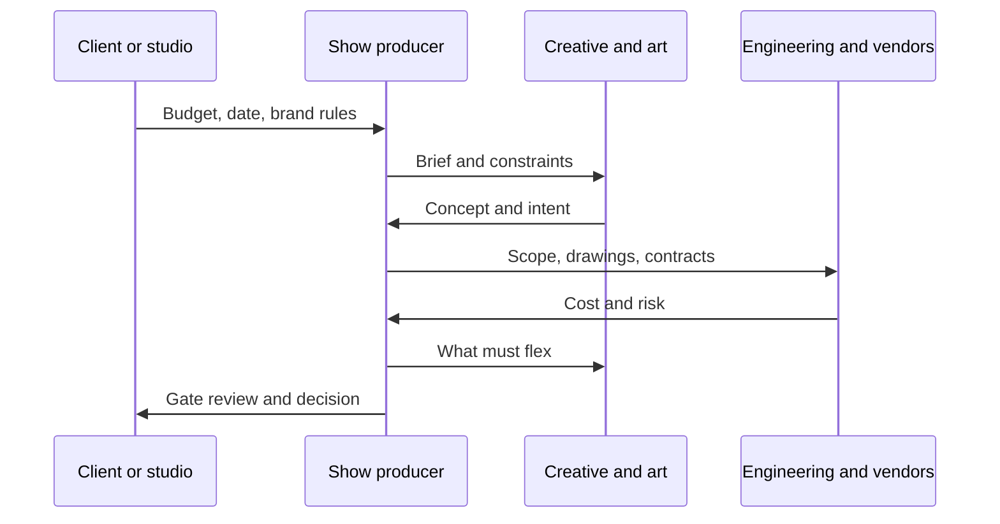

Every attraction has a person whose phone rings when anything goes wrong. In themed entertainment that is usually the show producer, or project lead. The role sits between the creative team, the engineers and vendors, and the client who signs the cheques. It owns the schedule, the budget, the contracts and the risk register, and it chairs the moments where those force a creative choice.

Shelby Honea, show producer on VelociCoaster, describes working with the filmmakers to settle where the ride sat in the Jurassic World canon, then driving the team quickly into animatics so decisions could be made against something rideable. Universal's Hagrid's team describe a fast-tracked schedule, roughly half the usual time, which is a producer's problem before it is anyone else's. Budget writers warn that late cuts are almost always the result of an unrealistic first number, and producers are the people who refuse to accept one. The role is the heart of the industry's [production roles](../careers/project-and-production-roles.md), the owner of the [capital budget](../operations-business/capital-budgets.md) on the ground, and the person who decides when [value engineering](../design-process/scope-and-value-engineering.md) is honest and when it is theft. Titles vary between studios, so treat this as a sketch.

## Explore further
- `blooloop-velocicoaster-design` — Universal Orlando's new VelociCoaster: more teeth, more thrills
- `themeparkinsider-hagrids-universal-creative` — How Universal Creative Brought Hagrid's Magic to Life
- `iaapa-funworld-busted-budgets` — Avoiding Busted Budgets (IAAPA Funworld)
