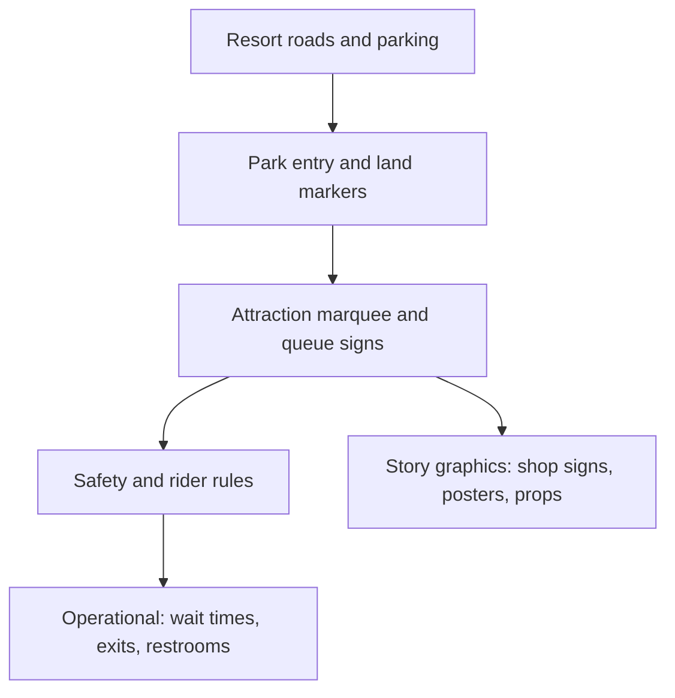

Every sign in a park is doing two jobs at once: getting a guest where they want to go and staying inside the fiction. Environmental graphic designers handle both. Wayne Hunt, a TEA Master, was among the first to turn park signs into strategic wayfinding programmes, and his firm worked with Walt Disney Imagineering from Space Mountain in 1979 through Shanghai Disneyland. His verdict is that good signage returns far more than it costs.

The system runs in layers, from motorway directionals to a shop's hand-lettered window. Each layer has a different voice. Safety and height-rule signs must be plain and consistent; story graphics can be ornate because their job is [environmental storytelling](../story-experience/environmental-storytelling.md). A well-known Disney lesson pairs a colour, a shape, a word and a number so guests can recognise an exit or a location. Fabrication ranges from routed and gilded wood to printed vinyl to cast metal, and every piece must survive weather and cleaning. Good graphics support [wayfinding](../human-factors/wayfinding.md) without becoming [visual intrusion](../human-factors/visual-intrusion.md), follow a [signage hierarchy](../human-factors/signage-hierarchy.md), and in international parks must carry several [languages](../human-factors/multilingual-design.md) without turning into a wall of text.

## Explore further
- `tea-masters-wayne-hunt` — TEA Masters: Wayne Hunt
- `mouseplanet-wayfinding-at-disney` — Wayfinding at Disney
