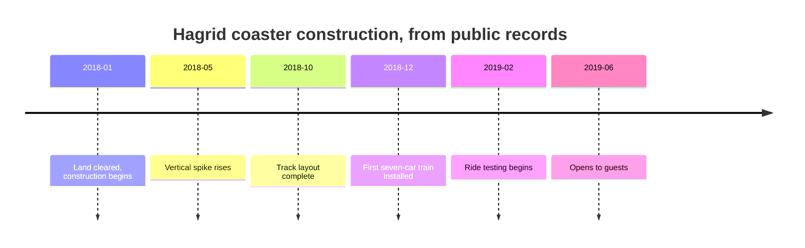

Theme park construction is ordinary building work made strange by its neighbours. Foundations, steel frames, concrete decks and roofs go up much as they would for a warehouse, but the warehouse must hide inside a story, the site is often a wedge between operating rides, and every crane is visible from a queue. On VelociCoaster the team worked with construction crews to thread the ride between an existing lagoon and attractions that stayed open on every side.

Sequencing matters. Hagrid's site was cleared in January 2018, its tallest element rose by May, track was finished by October and the first train sat on it that December, roughly eighteen months before opening. Expedition Everest took about three years to build after six years of planning, used tens of miles of rebar and thousands of tons of steel, and swapped scaffolding for poles pushed through the mountain's skin. Whole parks run longer: Epic Universe was announced in August 2019, paused for the pandemic, and opened in May 2025. Construction decides where [foundations](../ride-engineering/supports-and-foundations.md) go, how [backstage](../masterplanning/onstage-backstage.md) access survives, and which [sightlines](../story-experience/sightlines.md) get spoiled for a season. Building with the next [phase](../masterplanning/expansion-and-phasing.md) in mind saves digging twice.

## Explore further
- `wikipedia-hagrids-motorbike-adventure` — Hagrid's Magical Creatures Motorbike Adventure (Wikipedia)
- `wikipedia-expedition-everest` — Expedition Everest (Wikipedia)
- `blooloop-velocicoaster-design` — Universal Orlando's new VelociCoaster: more teeth, more thrills
- `wikipedia-epic-universe` — Universal Epic Universe (Wikipedia)
