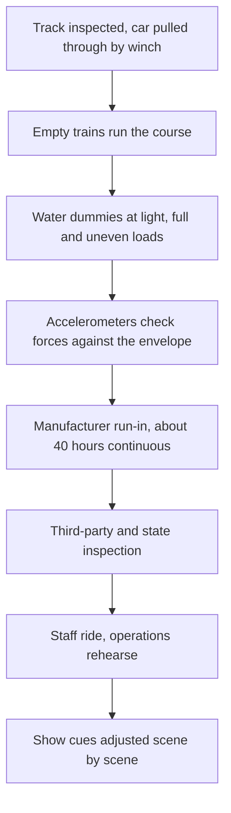

A ride is never finished when the last bolt is tight. Commissioning is the period, often months, in which the ride and show are run, measured and adjusted until they behave the same way every time. Parks call the show side "testing and adjusting." The engineering side follows a familiar ladder. The track is inspected and a car is winched through. Empty trains cycle. Water-filled dummies ride at light, full and lopsided loads while accelerometers on board confirm the forces stay inside the [acceleration envelope](../ride-engineering/acceleration-envelopes.md). The manufacturer then runs the system continuously, forty hours in one park's account, watching the control system for faults, before an outside inspector examines the ride and the park begins its own testing.

Hagrid's coaster had trains on its track in December 2018 and began ride testing that February for a June opening. Rise of the Resistance opened fourteen weeks after its land, a public sign of how long complex show systems take to settle. Commissioning also proves the [block system](../ride-engineering/block-system.md), writes the [dispatch procedures](../safety-standards/dispatch-procedures.md) operators will follow, and produces the records that [inspections](../safety-standards/inspections.md) and [national inspection schemes](../safety-standards/national-inspection-schemes.md) will ask for every year afterwards.

## Explore further
- `lvpm-dorney-coaster-testing` — Thrill-seeker safety: Rigorous testing of Dorney's new roller coaster
- `wikipedia-hagrids-motorbike-adventure` — Hagrid's Magical Creatures Motorbike Adventure (Wikipedia)
- `wikipedia-rise-of-the-resistance` — Star Wars: Rise of the Resistance (Wikipedia)
