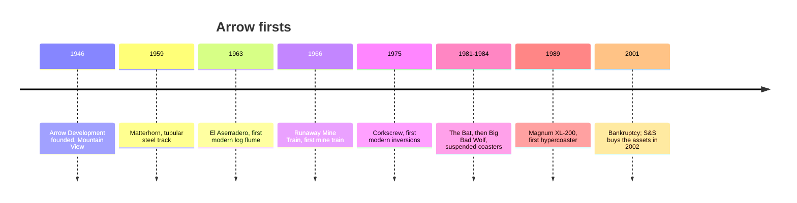

Arrow Development was founded in 1946 in Mountain View, California by Ed Morgan, Karl Bacon, Bill Hardiman and Andy Anderson. Walt Disney hired it for Disneyland's early rides and then for the Matterhorn, where it bent the first permanent tubular steel track, the [tubular steel breakthrough](../history/tubular-steel-breakthrough.md). It also built the boats for it's a small world and Pirates, the root of the [boat dark ride](../ride-systems/boat-dark-ride.md).

For thirty years Arrow kept inventing categories. El Aserradero at Six Flags Over Texas in 1963 was the first modern [log flume](../ride-systems/log-flume.md); the Runaway Mine Train followed in 1966. The Corkscrew of 1975 brought back inversions and was cloned ten times. The Bat in 1981 and Big Bad Wolf in 1984 established the swinging suspended coaster, ancestor of the [suspended dark ride](../ride-systems/suspended-dark-ride.md) family. Magnum XL-200 in 1989 started the height race.

The company was reorganised as Arrow Dynamics in 1986, and its later coasters became known for jolting transitions, the reference case for [rough rides](../ride-engineering/rough-rides.md). It filed for bankruptcy on December 3, 2001, and S&S bought the remains in 2002. Arrow's rise and fall is a compact lesson in [industry structure](../operations-business/industry-structure.md): a firm can own every first and still lose to smoother competitors.

## Explore further
- `wikipedia-arrow-dynamics` — Arrow Dynamics
- `wikipedia-matterhorn-bobsleds` — Matterhorn Bobsleds
- `wikipedia-magnum-xl-200` — Magnum XL-200
- `wikipedia-corkscrew-silverwood` — Corkscrew
