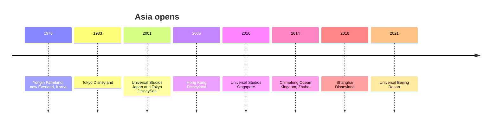

```vega-lite
{
  "$schema": "https://vega.github.io/schema/vega-lite/v5.json",
  "title": "Chimelong Ocean Kingdom attendance, millions (Wikipedia)",
  "width": 300, "height": 140,
  "data": {"values": [
    {"year": 2014, "m": 5.5}, {"year": 2019, "m": 11.7}, {"year": 2020, "m": 4.8}, {"year": 2022, "m": 4.4}, {"year": 2023, "m": 12.5}, {"year": 2024, "m": 12.6}
  ]},
  "mark": {"type": "line", "point": true},
  "encoding": {"x": {"field": "year", "type": "quantitative", "axis": {"format": "d"}, "title": "Year"}, "y": {"field": "m", "type": "quantitative", "title": "Guests, millions"}}
}
```



Asia's parks began locally: Everland near Seoul opened in 1976 as Yongin Farmland under Samsung, and Tokyo Disneyland arrived in 1983 under a Japanese owner. The 2000s turned expansion into a race. Universal Studios Japan opened on March 31, 2001 and drew over 11 million guests in its first year; Tokyo DisneySea opened that September and beat it to 10 million in 307 days.

Each later park tested a different model. Hong Kong Disneyland (2005) was a government joint venture that under-performed its targets. Universal Studios Singapore (2010) sits inside a casino resort on Sentosa, a strong case of [resort integration](../masterplanning/resort-integration.md). Shanghai Disneyland (2016) rewrote the park for Chinese guests. Universal Beijing (2021) is 70% owned by a state enterprise and operated by Universal.

The surprise is domestic growth. Chimelong Ocean Kingdom in Zhuhai, opened in 2014, drew 12.6 million guests in 2024, more than any park outside Disney and Universal. For designers the region is the deepest study in [cultural differences](../human-factors/cultural-differences.md), from food to queue manners, and in [localisation](../human-factors/localisation.md) of stories. For planners it is a study in [site selection](../masterplanning/site-selection.md) near megacities and in [attendance modelling](../operations-business/roi-and-attendance-modeling.md) when the market is new. Disney's own story is in [Disney's global parks](../history/disney-global-parks.md).

## Explore further
- `wikipedia-tokyo-disneysea` — Tokyo DisneySea
- `wikipedia-universal-studios-japan` — Universal Studios Japan
- `wikipedia-chimelong-ocean-kingdom` — Chimelong Ocean Kingdom
- `wikipedia-universal-beijing-resort` — Universal Beijing Resort
