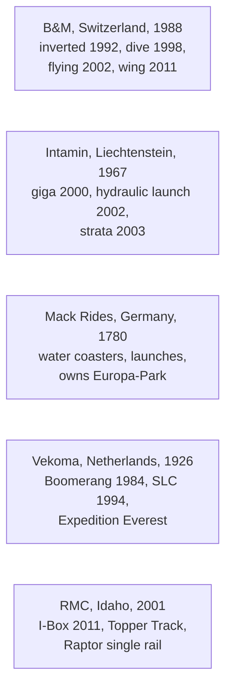

```vega-lite
{
  "$schema": "https://vega.github.io/schema/vega-lite/v5.json",
  "title": "Founding year of each firm (Wikipedia)",
  "width": 300, "height": 130,
  "data": {"values": [
    {"firm": "Mack Rides", "year": 1780}, {"firm": "Vekoma", "year": 1926}, {"firm": "Intamin", "year": 1967},
    {"firm": "B&M", "year": 1988}, {"firm": "RMC", "year": 2001}
  ]},
  "mark": {"type": "point", "filled": true, "size": 90},
  "encoding": {"x": {"field": "year", "type": "quantitative", "scale": {"domain": [1770, 2010]}, "axis": {"format": "d"}, "title": "Founded"}, "y": {"field": "firm", "type": "nominal", "sort": null, "title": null}}
}
```

Five builders shape most modern coasters, and each has a recognisable hand. Bolliger & Mabillard, founded in 1988 by two engineers from Giovanola, is known for smooth, over-engineered rides: Batman The Ride of 1992 was the first [inverted coaster](../ride-systems/inverted-coasters.md), Oblivion of 1998 the first [dive coaster](../ride-systems/dive-coasters.md), then flying coasters in 2002 and wing coasters in 2011.

Intamin, founded in 1967 in Liechtenstein, chases records: Millennium Force, the hydraulic Accelerator line, Top Thrill Dragster, Kingda Ka and Formula Rossa. Mack Rides traces itself to a wagon builder of 1780, entered the showman trade in 1880, and since 1975 has used its own Europa-Park as a showroom; its [water coasters](../ride-systems/water-coaster.md) and launched Blue Fire (2009) define a family-friendly style. Vekoma, founded in 1926 as a Dutch machine works, built the industry's volume models, the Boomerang (1984) and the SLC (1994), as well as Expedition Everest, and was bought by Sansei in 2018. Rocky Mountain Construction, founded in 2001, invented the I-Box [hybrid coaster](../ride-systems/hybrid-coasters.md) and the single-rail Raptor.

Together they illustrate the [industry structure](../operations-business/industry-structure.md): a few specialist firms, often family-owned, serving a global park market. The rides they built are traced in [coaster milestones](../history/coaster-milestones.md).

## Explore further
- `wikipedia-bolliger-mabillard` — Bolliger & Mabillard
- `wikipedia-intamin` — Intamin
- `wikipedia-mack-rides` — Mack Rides
- `wikipedia-vekoma` — Vekoma
