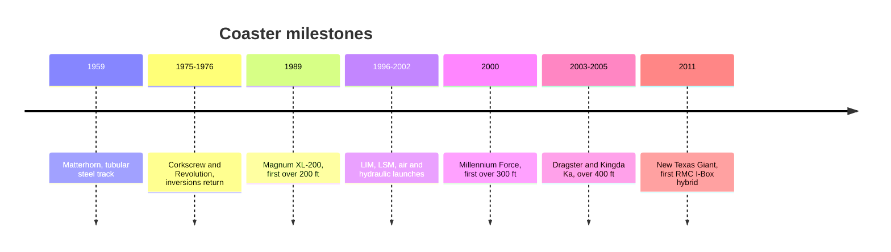

```vega-lite
{
  "$schema": "https://vega.github.io/schema/vega-lite/v5.json",
  "title": "Tallest full-circuit coaster at opening, feet (Wikipedia)",
  "width": 300, "height": 140,
  "data": {"values": [
    {"year": 1989, "ft": 205, "name": "Magnum XL-200"}, {"year": 2000, "ft": 310, "name": "Millennium Force"},
    {"year": 2003, "ft": 420, "name": "Top Thrill Dragster"}, {"year": 2005, "ft": 456, "name": "Kingda Ka"}
  ]},
  "mark": {"type": "line", "point": true},
  "encoding": {
    "x": {"field": "year", "type": "quantitative", "title": "Year", "axis": {"format": "d"}},
    "y": {"field": "ft", "type": "quantitative", "title": "Height, ft"},
    "tooltip": [{"field": "name"}, {"field": "ft"}]
  }
}
```

The roller coaster's history after 1955 is a series of unlocks, each the moment a new material, element or motor made a new ride possible. This group follows six of them. The [tubular steel breakthrough](../history/tubular-steel-breakthrough.md) of 1959 let track curve in three dimensions. The [loop revival](../history/loop-revival.md) of 1975 and 1976 brought inversions back after seventy years, thanks to better [track geometry](../ride-engineering/track-geometry.md). The [hyper and giga era](../history/hyper-and-giga-era.md) chased height from 200 to 300 ft, and the [strata coasters](../history/strata-coasters.md) pushed past 400 ft. The [launch era](../history/launch-era.md) replaced the lift hill with magnets, air and hydraulics. And the [RMC hybrid era](../history/rmc-hybrid-era.md) gave old wooden coasters new steel rails and wilder profiles.

Two threads tie them together. Every record is limited by what the body tolerates, so [g-tolerance and duration](../ride-engineering/g-tolerance-and-duration.md) set the ceiling long before steel does. And every record is a marketing event aimed at [sensation seekers](../human-factors/sensation-seeking.md), which is why the "coaster wars" of 1989 to 2005 were fought between a few parks and a few [manufacturers](../history/coaster-manufacturers.md). RCDB keeps the census.

## Explore further
- `wikipedia-history-of-the-roller-coaster` — History of the roller coaster
- `rcdb-home` — Roller Coaster DataBase
- `wikipedia-magnum-xl-200` — Magnum XL-200
- `wikipedia-kingda-ka` — Kingda Ka
