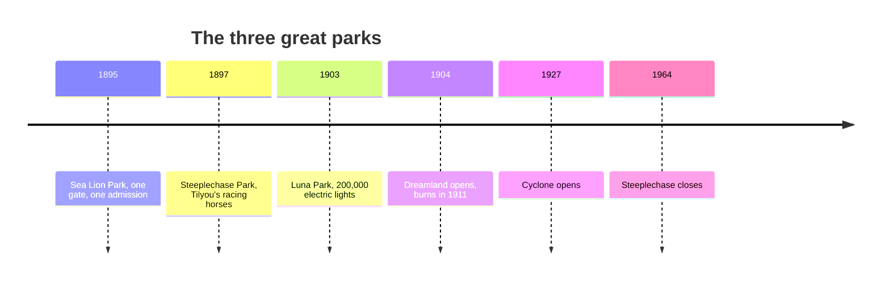

*Photo: Detroit Publishing Co., public domain, via Wikimedia Commons — [source](https://commons.wikimedia.org/wiki/File:Night_in_Luna_Park,_Coney_Island_(1905).jpg)*

Coney Island is where the fairground became a park. Sea Lion Park in 1895 fenced its rides and charged one admission at one gate. Steeplechase followed in 1897, built by George Tilyou around his gravity-powered mechanical horses. Then Frederic Thompson and Elmer Dundy opened Luna Park in 1903 with a skyline of towers and over 200,000 electric lights, which grew to more than a million by 1912. A year later Dreamland copied the trick in white.

The design lessons are still fresh. Luna Park is early proof that [architecture can be a character](../story-experience/architecture-as-character.md): the buildings were the show. Its lighting is the ancestor of every [night-time spectacular](../show-technology/nighttime-spectaculars.md). The single gate created the idea of an [entry sequence](../masterplanning/entry-sequence.md) that a guest passes through once.

Coney also shows the limits of spectacle without story. Fires destroyed Steeplechase in 1907 and Dreamland in 1911; the rebuilt Steeplechase used fireproof steel and concrete, an early case for [lessons from incidents](../safety-standards/lessons-from-incidents.md). By 1964 Steeplechase closed, and the gap it left was filled by [Disneyland](../history/disneyland-1955.md).

## Explore further
- `wikipedia-coney-island` — Coney Island
- `wikipedia-luna-park-1903` — Luna Park, Coney Island (1903)
- `wikipedia-steeplechase-park` — Steeplechase Park
- `coney-island-history-project` — Coney Island History Project
