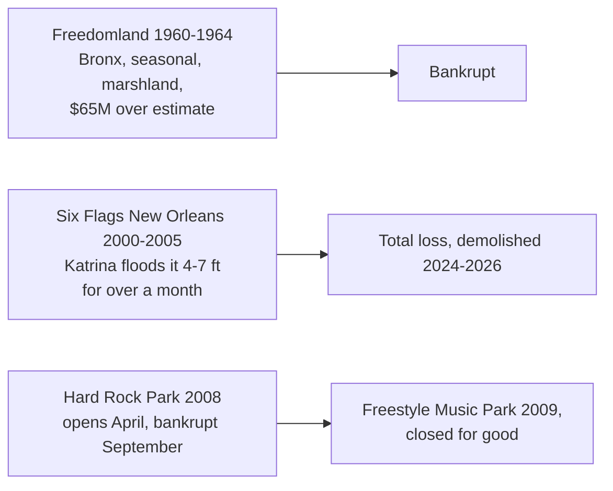

```vega-lite
{
  "$schema": "https://vega.github.io/schema/vega-lite/v5.json",
  "title": "Years open before closure (Wikipedia)",
  "width": 300, "height": 110,
  "data": {"values": [{"park": "Freedomland U.S.A.", "y": 5}, {"park": "Six Flags New Orleans", "y": 6}, {"park": "Hard Rock Park", "y": 2}]},
  "mark": "bar",
  "encoding": {"y": {"field": "park", "type": "nominal", "title": null}, "x": {"field": "y", "type": "quantitative", "title": "Seasons operated"}}
}
```

Parks fail in predictable ways; three cases cover most of them. Freedomland U.S.A. opened in the Bronx on June 19, 1960, designed by Disneyland planner C. V. Wood as a map of the United States. It opened only three or four months a year, cost about $65 million against a far lower estimate, sat on marshland that damaged its buildings, and lacked a clear draw. It went bankrupt days after closing in September 1964: a lesson in [seasonality](../operations-business/seasonality-and-events.md), [site selection](../masterplanning/site-selection.md) and [feasibility and early costing](../design-process/feasibility-and-early-costing.md) all at once.

Six Flags New Orleans opened as Jazzland in 2000. Its last day was August 21, 2005; Hurricane Katrina then left it under four to seven feet of brackish water for over a month. Six Flags declared it a total loss, and the ruin was cleared by 2026, an extreme end to a [ride lifecycle](../operations-business/ride-lifecycle.md).

Hard Rock Park in Myrtle Beach opened in April 2008 and was bankrupt by September; a relaunch as Freestyle Music Park lasted one season. Over-ambitious [capital budgets](../operations-business/capital-budgets.md) in a recession did the rest. Defunctland, running since 2017, is the best-known chronicle of such stories and a staple of [podcasts and channels](../careers/podcasts-and-channels.md).

## Explore further
- `wikipedia-freedomland` — Freedomland U.S.A.
- `wikipedia-six-flags-new-orleans` — Six Flags New Orleans
- `wikipedia-hard-rock-park` — Hard Rock Park
- `youtube-defunctland` — Defunctland (YouTube)
