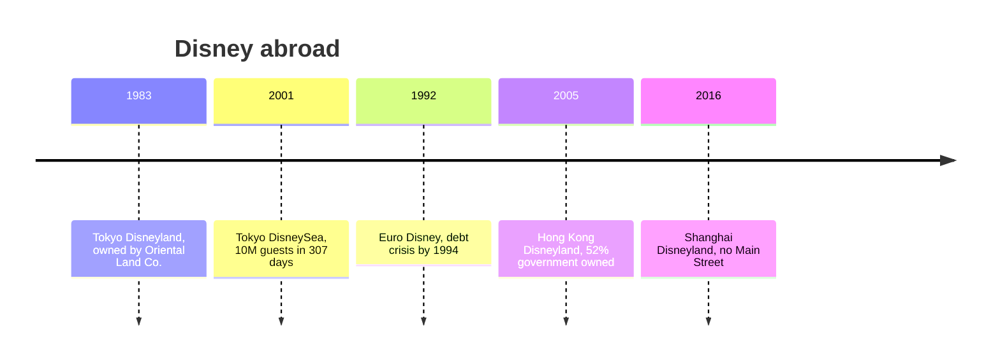

```vega-lite
{
  "$schema": "https://vega.github.io/schema/vega-lite/v5.json",
  "title": "Disney's ownership share at opening (Tokyo is licensed, 0%; Paris 49% before 1994)",
  "width": 300, "height": 130,
  "data": {"values": [
    {"park": "Tokyo 1983", "share": 0}, {"park": "Paris 1992", "share": 49},
    {"park": "Hong Kong 2005", "share": 48}, {"park": "Shanghai 2016", "share": 43}
  ]},
  "mark": "bar",
  "encoding": {
    "x": {"field": "park", "type": "nominal", "sort": null, "title": null},
    "y": {"field": "share", "type": "quantitative", "title": "Disney share, %"}
  }
}
```



Disney's overseas parks are a controlled experiment in what travels. Tokyo Disneyland, opened April 15, 1983, is owned and run by the Oriental Land Company under licence; Disney collects royalties and the Japanese owner reinvests heavily, which is why Tokyo DisneySea reached 10 million guests in 307 days. Euro Disney opened April 12, 1992 with Disney as a large shareholder and a resort too big for its attendance; by 1994 it carried about $3 billion of debt and was renamed Disneyland Paris during a rescue.

Hong Kong Disneyland (2005) is 52% owned by the government. Its designers followed feng shui advice, bending the entry walkway so good energy would not flow out to sea, an unusually explicit case of [localisation](../human-factors/localisation.md). Even so it missed its first-year target of 5.6 million. Shanghai Disneyland (2016) went further: no Main Street, a Mickey Avenue instead, mostly Chinese food, and the largest castle of any Disney park, under the slogan "Authentically Disney, Distinctly Chinese".

Together they show [cultural differences](../human-factors/cultural-differences.md) in what guests eat, how they queue and what stories land, and the financial side of [IP licensing economics](../operations-business/ip-licensing-economics.md) and [attendance modelling](../operations-business/roi-and-attendance-modeling.md). The wider story continues in [Asian expansion](../history/asian-expansion.md).

## Explore further
- `wikipedia-tokyo-disneyland` — Tokyo Disneyland
- `wikipedia-disneyland-paris` — Disneyland Paris
- `wikipedia-hong-kong-disneyland` — Hong Kong Disneyland
- `wikipedia-shanghai-disneyland` — Shanghai Disneyland
