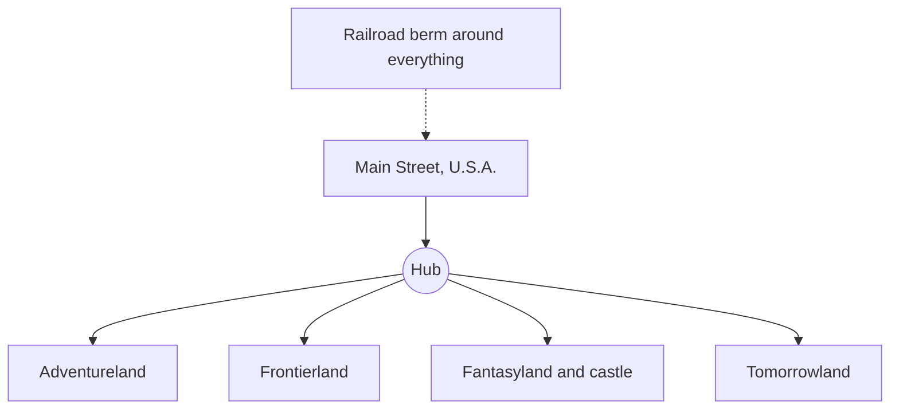

```vega-lite
{
  "$schema": "https://vega.github.io/schema/vega-lite/v5.json",
  "title": "Opening-day attractions by land, from the D23 list of twenty",
  "width": 300, "height": 120,
  "data": {"values": [
    {"land": "Main Street", "n": 6}, {"land": "Fantasyland", "n": 5}, {"land": "Frontierland", "n": 5},
    {"land": "Tomorrowland", "n": 3}, {"land": "Adventureland", "n": 1}
  ]},
  "mark": "bar",
  "encoding": {
    "x": {"field": "n", "type": "quantitative", "title": "Attractions"},
    "y": {"field": "land", "type": "nominal", "sort": "-x", "title": null}
  }
}
```

Disneyland was dedicated on July 17, 1955 and opened to the public the next day. It cost about $17 million and launched with twenty attractions across Main Street, U.S.A., Adventureland, Frontierland, Fantasyland and Tomorrowland. The press preview is remembered as Black Sunday: heat, counterfeit tickets, drink shortages, broken rides and a riverboat overloaded with guests. Publicist Eddie Meck spent two years inviting reporters back to see the park working properly.

The plan is the lasting lesson. A single entrance street leads to a [hub](../masterplanning/hub-and-spoke.md) from which every land radiates, so guests always know the way back. A railroad [berm](../story-experience/the-berm.md) hides the outside world. The castle and the Main Street buildings use [forced perspective](../story-experience/forced-perspective.md) to feel taller than they are, and each land has a visual [weenie](../story-experience/weenies.md) that pulls people onward.

Opening day is also an early case study in [capacity versus demand](../operations-business/capacity-vs-demand.md), and a reason modern parks prefer a quiet [soft opening](../design-process/soft-opening.md) to a live television broadcast.

## Explore further
- `wikipedia-disneyland` — Disneyland
- `d23-disneyland-a-to-z` — Disneyland, Disney A to Z (D23)
- `d23-this-day-disneyland-opens` — Disneyland Opens, This Day in Disney History (D23)
- `wdfm-walt-disney-family-museum` — The Walt Disney Family Museum
