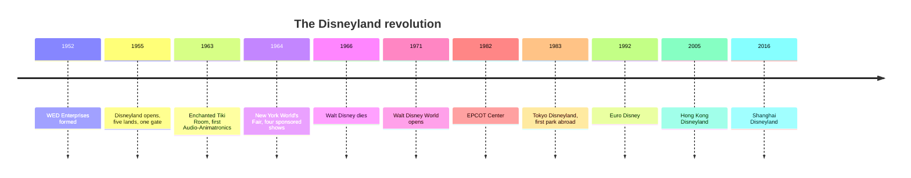

Before 1955 an amusement park was a collection of rides. After [Disneyland](../history/disneyland-1955.md) it could be a place with a story. Walt Disney took the single-gate enclosure from Coney Island, the garden calm of Tivoli, and the craft of film, and asked a studio team to build a three-dimensional movie you could walk through. That is the root of [themed storytelling](../story-experience/themed-storytelling.md) as a discipline.

The revolution had four parts. [Walt and the Imagineers](../history/walt-and-the-imagineers.md) created a new kind of design team, WED Enterprises, that invented Audio-Animatronics and the [hub-and-spoke](../masterplanning/hub-and-spoke.md) plan. The [1964 World's Fair](../history/worlds-fair-1964.md) showed that corporate sponsors would pay for shows the park could keep. [Walt Disney World and EPCOT](../history/walt-disney-world-and-epcot.md) scaled the idea to a resort with its own [onstage and backstage](../masterplanning/onstage-backstage.md) infrastructure. And [Disney's global parks](../history/disney-global-parks.md) exported the model, with mixed results in Paris and Hong Kong and strong ones in Tokyo and Shanghai.

The industry still lives in the structure Disney set: a creative studio, a capital-heavy resort model, and competitors who define themselves against it.

## Explore further
- `wikipedia-disneyland` — Disneyland
- `wikipedia-walt-disney-imagineering` — Walt Disney Imagineering
- `wikipedia-walt-disney-world` — Walt Disney World
- `wikipedia-1964-worlds-fair` — 1964 New York World's Fair
