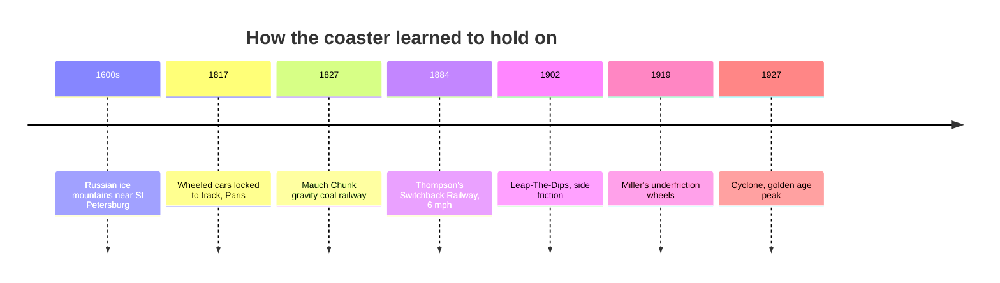

*Image: unknown artist, 1884, public domain, via Wikimedia Commons — [source](https://commons.wikimedia.org/wiki/File:Thompsons_Switchback_Railway_1884.jpg)*

Early coasters are a story about wheels. The first were not coasters at all: 17th-century Russian ice slides, 70 to 80 ft high, reinforced with timber. In 1817 Paris added wheeled cars locked to a track with guide rails. In Pennsylvania, the Mauch Chunk coal railway of 1827 found a second life carrying tourists downhill for fun.

LaMarcus Thompson's Switchback Railway opened at Coney Island on June 16, 1884. Riders climbed a tower, coasted across at just over 6 mph, and were switched to a second track for the return. It is a textbook case of [energy conversion](../ride-engineering/energy-conversion.md): height in, speed out, nothing else. Leap-The-Dips (1902), the oldest standing coaster, used side-friction guidance, so hills had to stay gentle.

The breakthrough came in 1919 when John Miller added wheels under the rail. Cars could no longer lift off, so drops got steeper and the 1920s golden age of [wooden coasters](../ride-systems/wooden-coasters.md) followed. Those three-wheel assemblies are the direct ancestors of modern [wheels and bogies](../ride-engineering/wheels-and-bogies.md), and Miller's safety ratchets are the origin of [anti-rollback](../ride-engineering/anti-rollback.md) devices. The next leap was the [tubular steel breakthrough](../history/tubular-steel-breakthrough.md) of 1959.

## Explore further
- `wikipedia-switchback-railway` — Switchback Railway
- `wikipedia-russian-mountains` — Russian Mountains
- `wikipedia-history-of-the-roller-coaster` — History of the roller coaster
- `wikipedia-leap-the-dips` — Leap-The-Dips
