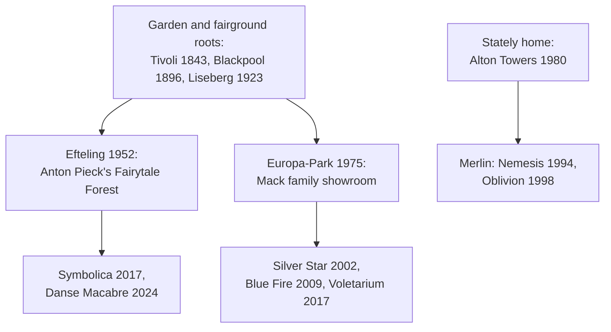

```vega-lite
{
  "$schema": "https://vega.github.io/schema/vega-lite/v5.json",
  "title": "Efteling attendance milestones from the park's own history, millions",
  "width": 300, "height": 130,
  "data": {"values": [{"year": 1952, "m": 0.22}, {"year": 1953, "m": 0.41}, {"year": 1956, "m": 0.7}, {"year": 1978, "m": 1.45}, {"year": 2017, "m": 5.0}]},
  "mark": {"type": "line", "point": true},
  "encoding": {"x": {"field": "year", "type": "quantitative", "axis": {"format": "d"}, "title": "Year"}, "y": {"field": "m", "type": "quantitative", "title": "Guests, millions"}}
}
```

Europe's parks grew from gardens and fairgrounds, and it shows. Efteling opened its Fairytale Forest in 1952 in the Dutch woods, drawn by illustrator Anton Pieck in about 1,500 sketches: walk-through scenes of Sleeping Beauty and the Frog Prince, with no ride system at all. It passed five million visitors in 2017, the year Symbolica opened, and built Danse Macabre in 2024. It is the purest example of [story-driven design](../story-experience/story-driven-design.md) without a film.

Europa-Park opened in Rust on July 12, 1975 as the Mack family's showroom and became a park of 18 European-themed areas, with Silver Star (2002), Blue Fire (2009) and the Voletarium flying theatre (2017). Liseberg (1923) in Gothenburg and Blackpool Pleasure Beach (1896) descend from the seaside and city fair; Blackpool's Big One was the world's tallest coaster in 1994. Alton Towers turned a stately-home estate into a theme park on April 4, 1980 and later gave Europe its first inverted coaster, Nemesis.

Common traits run through them: dense [planting design](../sensory-environment/planting-design.md), heavy use of [seasonal overlays](../sensory-environment/seasonal-overlays.md) such as winter openings, and a fondness for [family coasters](../ride-systems/family-coasters.md) over record-breakers. The tradition stands in deliberate contrast to the [IP wars](../history/ip-wars.md), and [Symbolica](../history/symbolica.md) is its modern flagship.

## Explore further
- `efteling-official-history` — History of Efteling (official)
- `wikipedia-europa-park` — Europa-Park
- `wikipedia-liseberg` — Liseberg
- `wikipedia-alton-towers` — Alton Towers
