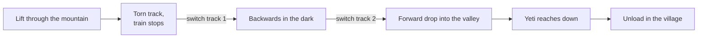

*Photo: WillMcC, CC BY-SA 3.0, via Wikimedia Commons — [source](https://commons.wikimedia.org/wiki/File:Expedition_Everest_overview_(Disney%27s_Animal_Kingdom).jpg)*

Expedition Everest opened at Disney's Animal Kingdom on April 7, 2006 after six years and about $100 million, then the most expensive coaster. Vekoma built the [steel coaster](../ride-systems/steel-coasters.md); Joe Rohde led the design after research trips to Nepal. The mountain is 199.5 ft tall, chosen to stay under the 200 ft line that would require an aviation beacon.

The ride is a story told by track. The train climbs, finds the rails torn away, and stops. A switch track swings behind it and it falls backwards into darkness; a second switch sends it forward through a big drop and past the Yeti. It was the first Disney coaster to change direction mid-ride, and the stop is a textbook [reveal and concealment](../story-experience/reveal-and-concealment.md) beat.

The village queue and its Yeti museum are [environmental storytelling](../story-experience/environmental-storytelling.md) built from real artefacts. The [rockwork](../design-process/rockwork.md) is composed so that [sightlines](../story-experience/sightlines.md) from across the park read as a Himalayan range.

The cautionary tale is the Yeti. The 25 ft figure, the largest and most complex Disney had built, split its frame within months and has run in a strobe-lit B-mode since, nicknamed the Disco Yeti, a famous case of [figure reliability](../show-technology/figure-reliability.md).

## Explore further
- `wikipedia-expedition-everest` — Expedition Everest
- `d23-legend-joe-rohde` — Joe Rohde, Disney Legends
- `wikipedia-vekoma` — Vekoma
