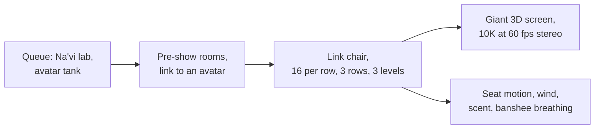

```vega-lite
{
  "$schema": "https://vega.github.io/schema/vega-lite/v5.json",
  "title": "Illustrative: cues that build the sense of flying",
  "width": 300, "height": 140,
  "data": {"values": [
    {"cue": "Wide 3D visual", "weight": 5}, {"cue": "Seat pitch and roll", "weight": 3},
    {"cue": "Wind and mist", "weight": 2}, {"cue": "Scent", "weight": 1}, {"cue": "Breathing between legs", "weight": 2}
  ]},
  "mark": "bar",
  "encoding": {"y": {"field": "cue", "type": "nominal", "sort": "-x", "title": null}, "x": {"field": "weight", "type": "quantitative", "title": "Contribution, illustrative"}}
}
```

Avatar Flight of Passage opened on May 27, 2017 with Pandora at Disney's Animal Kingdom, the land Joe Rohde led. Riders straddle a link chair, a motorcycle-like seat, in rows of sixteen on three levels, and face a vast screen showing stereo media rendered at 10K and 60 frames per second. Walt Disney Imagineering built it with Lightstorm and Weta Digital, and it won a 2018 Visual Effects Society award.

It is the most refined [flying theatre](../ride-systems/flying-theatre.md) yet because it stacks cues. The wide [stereoscopic 3D](../show-technology/stereoscopic-3d.md) image fills peripheral vision, which triggers [vection](../human-factors/vection.md), the feeling of self-motion when only the picture moves. The seat adds small pitch and roll, and wind, mist and scent follow the scene. A subtle expansion between the rider's legs mimics the creature breathing, a quiet piece of [haptics](../ai-future/haptics-and-next-gen-motion.md) that many riders remember most.

The result is high [presence](../human-factors/presence.md) from a seat that barely moves. The media pipeline, with film-quality rendering at game-engine frame rates, previews the role of [real-time engines](../ai-future/real-time-engines.md) in future attractions.

## Explore further
- `wikipedia-flight-of-passage` — Avatar Flight of Passage
- `wikipedia-disneys-animal-kingdom` — Disney's Animal Kingdom
- `d23-legend-joe-rohde` — Joe Rohde, Disney Legends
