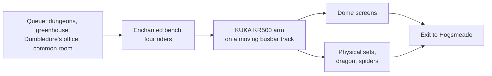

*Photo: Carlos Cruz, CC BY-SA 3.0, via Wikimedia Commons — [source](https://commons.wikimedia.org/wiki/File:Wizarding_World_of_Harry_Potter_Castle.jpg)*

Harry Potter and the Forbidden Journey opened on June 18, 2010 as the heart of the Wizarding World at Islands of Adventure. Riders sit four to a bench held by a KUKA KR500 industrial robot arm. The arm rides a busbar track through the building, so it can swing, tilt and hang its passengers in front of dome screens and physical sets in turn. This RoboCoaster G2 setup is the defining [robot arm ride](../ride-systems/robot-arm-ride.md), and its [dome and wraparound screens](../show-technology/domes-and-wraparound-screens.md) hide their edges from a moving viewpoint.

The queue is the other landmark. Guests walk through Hogwarts: the dungeons, the greenhouses, Dumbledore's office, the Defence Against the Dark Arts classroom and the Gryffindor common room, with talking portraits along the way. It is [queue storytelling](../story-experience/queue-storytelling.md) on the scale of a museum and the most complete [IP adaptation](../story-experience/ip-adaptation.md) of its era.

The business result reshaped the industry. Islands of Adventure went from 4.6 million guests in 2009 to 7.7 million in 2011, up two-thirds, a case used in [attendance modelling](../operations-business/roi-and-attendance-modeling.md). One caveat: the arm's swinging motion against screens makes some riders queasy, a reminder that [motion sickness](../human-factors/motion-sickness.md) scales with ambition. Versions opened in Osaka in 2014 and Hollywood in 2016.

## Explore further
- `wikipedia-forbidden-journey` — Harry Potter and the Forbidden Journey
- `wikipedia-wizarding-world-orlando` — The Wizarding World of Harry Potter (Universal Orlando)
- `wikipedia-islands-of-adventure` — Universal Islands of Adventure
