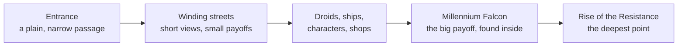

Galaxy's Edge is Disney's answer to the Wizarding World. Disney agreed to buy Lucasfilm on October 30, 2012 for $4.05 billion, naming theme parks among the uses for its stories. The land opened at Disneyland on May 31, 2019 and at Disney's Hollywood Studios on August 29, 2019, 14 acres each.

It is not a Star Wars-themed area but a place inside the story: Black Spire Outpost on the planet Batuu. Cast members greet guests with "bright suns", carry a backstory and a side, and mix their own costumes, which is [cast role-play](../story-experience/cast-role-play.md) applied to every shopkeeper. Even the drinks are restyled for the planet; see [total-immersion lands](../story-experience/immersive-lands.md). Shops sell experiences, such as building a lightsaber; see [retail as attraction](../operations-business/retail-as-attraction.md).

The layout uses [reveal and concealment](../story-experience/reveal-and-concealment.md). Entrances are modest, walled streets keep views short, and the Millennium Falcon is found deep inside rather than shown from the gate, a reading popularised by Wendover Productions. The land opened without its headline ride, [Rise of the Resistance](../history/rise-of-the-resistance.md), and early crowds fell short of forecasts.

## Explore further
- `wikipedia-galaxys-edge` — Star Wars: Galaxy's Edge
- `techcrunch-disney-lucasfilm-2012` — Disney To Buy 'Star Wars' Maker Lucasfilm For $4.05 Billion
- `clickondetroit-galaxys-edge-immersion` — Star Wars: Galaxy's Edge: Is it the most immersive land Disney has built?
- `wendover-how-to-design-a-theme-park` — How to Design a Theme Park (To Take Tons of Your Money)
