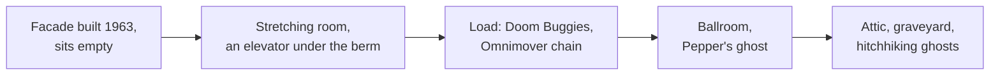

*Photo: SolarSurfer, public domain, via Wikimedia Commons — [source](https://commons.wikimedia.org/wiki/File:Haunted_Mansion_Exterior.JPG)*

The Haunted Mansion's facade was finished in 1963, then stood empty for six years while the team worked on the World's Fair and argued about tone. Marc Davis wanted gags; Claude Coats wanted dread. X Atencio's script let both win: the ride opens scary and ends as a party, a clean example of [fear versus fun](../human-factors/fear-vs-fun.md). It opened on August 9, 1969.

Three devices make it a landmark. The stretching room is an elevator, a [pre-show](../story-experience/pre-show.md) that also carries guests under the railroad [berm](../story-experience/the-berm.md) into a show building outside the park. The Doom Buggies are an [Omnimover](../ride-systems/omnimover.md) chain, first used in 1967, whose cars swivel so every rider looks exactly where the designer wants, a hard engineering solution to [visual attention](../human-factors/visual-attention.md). And the ballroom is the most famous [Pepper's ghost](../show-technology/peppers-ghost.md) in the world: the waltzing couples are reflections of lit figures below and above, seen through a huge pane of glass.

Versions followed at Magic Kingdom, Tokyo and Paris; Hong Kong got a ghost-free cousin, Mystic Manor.

## Explore further
- `wikipedia-the-haunted-mansion` — The Haunted Mansion
- `wikipedia-omnimover` — Omnimover
- `d23-legend-marc-davis` — Marc Davis, Disney Legends
- `d23-legend-claude-coats` — Claude Coats, Disney Legends
