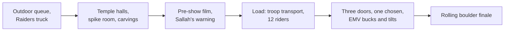

Temple of the Forbidden Eye opened at Disneyland on March 3, 1995, led by Tony Baxter with a core team of nearly a hundred Imagineers. Its vehicle looks like a battered troop transport for twelve, but it is an [Enhanced Motion Vehicle](../ride-systems/enhanced-motion-vehicle.md): a motion base on a tracked chassis. Hydraulics add lift, tilt and shudder while the car moves, so a modest speed feels like a reckless drive, a textbook use of [motion cueing](../ride-systems/motion-cueing.md).

The queue is almost as famous as the ride. It runs about half a mile from a Mercedes truck used in Raiders of the Lost Ark through booby-trapped chambers, a spike room and walls carved with a simple substitution cipher fans call Marabic. That is [queue storytelling](../story-experience/queue-storytelling.md) taken seriously: the wait is the first act. Props that guests could push and pull made it an early [interactive queue](../human-factors/interactive-queues.md), and the decoding game is pure [occupied time](../human-factors/occupied-time.md).

As an [IP adaptation](../story-experience/ip-adaptation.md) it is unusual: the temple is an original story set between the films rather than a retelling. Tokyo DisneySea's version, Temple of the Crystal Skull, opened in 2001, and the same vehicle later powered Dinosaur at Animal Kingdom.

## Explore further
- `wikipedia-indiana-jones-adventure` — Indiana Jones Adventure
- `d23-legend-tony-baxter` — Tony Baxter, Disney Legends
