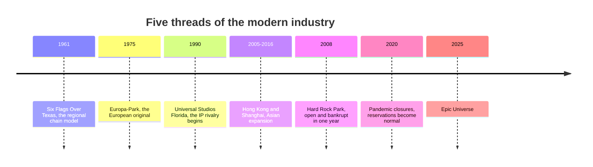

Disneyland proved the model; the next seventy years tested it. Angus Wynne's Six Flags Over Texas, opened August 5, 1961, showed that a themed park could serve one region without a film studio, and chains followed. Universal's 1990 Florida park, built after a public feud with Disney over Disney-MGM Studios, started the long rivalry over licensed worlds covered in [Universal and the IP wars](../history/ip-wars.md).

The map then moved. [Asian expansion](../history/asian-expansion.md) took Disney to Tokyo, Hong Kong and Shanghai and Universal to Osaka, Singapore and Beijing, while Chinese operators like Chimelong grew parks that out-draw most Western ones. Meanwhile the [European park tradition](../history/european-parks.md), from Efteling to Europa-Park and Liseberg, kept building original stories rather than licensed ones.

Not every bet paid. [Defunct parks and failures](../history/defunct-parks.md) such as Freedomland, Six Flags New Orleans and Hard Rock Park show how seasonality, debt and weather end parks. And the [pandemic and reservation era](../history/reservation-era.md) changed daily operations: dated reservations, virtual queues and paid priority became standard, a live case of [capacity versus demand](../operations-business/capacity-vs-demand.md).

Read together, these threads explain the present [industry structure](../operations-business/industry-structure.md) and the [IP licensing economics](../operations-business/ip-licensing-economics.md) behind most new lands.

## Explore further
- `wikipedia-six-flags-over-texas` — Six Flags Over Texas
- `wikipedia-universal-studios-florida` — Universal Studios Florida
- `wikipedia-shanghai-disneyland` — Shanghai Disneyland
- `wikipedia-walt-disney-world` — Walt Disney World
