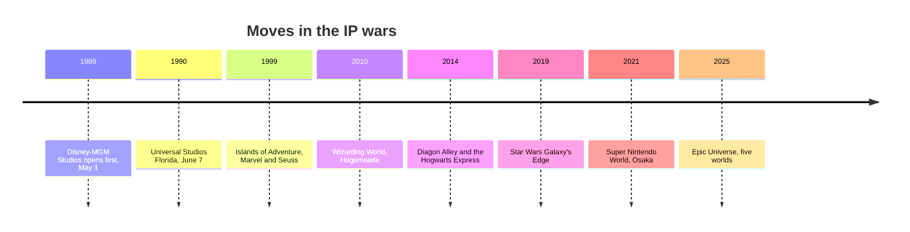

```vega-lite
{
  "$schema": "https://vega.github.io/schema/vega-lite/v5.json",
  "title": "Islands of Adventure attendance before and after Hogsmeade, millions (Wikipedia)",
  "width": 300, "height": 140,
  "data": {"values": [{"year": "2009", "m": 4.63}, {"year": "2010", "m": 5.95}, {"year": "2011", "m": 7.67}]},
  "mark": {"type": "line", "point": true},
  "encoding": {"x": {"field": "year", "type": "nominal", "title": null}, "y": {"field": "m", "type": "quantitative", "title": "Guests, millions"}}
}
```



The IP wars began with a grudge. Universal planned a studio park in Florida; in 1987 Michael Eisner announced Disney-MGM Studios, which opened on May 1, 1989, a year before Universal Studios Florida. Universal accused Disney of using knowledge of its plans; Disney denied it. Universal's answer was to build around other people's stories: Marvel and Seuss at Islands of Adventure in 1999, then Harry Potter.

Hogsmeade opened on June 18, 2010 and the park's attendance rose 36% that year, from 4.6 million in 2009 to 7.7 million by 2011. Diagon Alley followed in 2014, joined by a Hogwarts Express that requires a two-park ticket. It is the standard case for [attendance modelling](../operations-business/roi-and-attendance-modeling.md) and for [land design](../masterplanning/land-design.md) built as a world rather than a ride. Disney replied with Pandora in 2017 and Star Wars: Galaxy's Edge in 2019.

The current front is Nintendo. Super Nintendo World opened in Osaka in 2021 and Hollywood in 2023; its Power-Up Band wristband tracks coins and challenges, an early case of [wearables and identity](../operations-business/wearables-and-identity.md). Epic Universe, opened May 22, 2025, bundles five such worlds. Costs and royalties are covered in [IP licensing economics](../operations-business/ip-licensing-economics.md), the craft in [IP adaptation](../story-experience/ip-adaptation.md), and the studio in [Universal Creative](../history/universal-creative.md).

## Explore further
- `wikipedia-universal-studios-florida` — Universal Studios Florida
- `wikipedia-wizarding-world-orlando` — The Wizarding World of Harry Potter (Universal Orlando)
- `wikipedia-super-nintendo-world` — Super Nintendo World
- `wikipedia-epic-universe` — Universal Epic Universe
