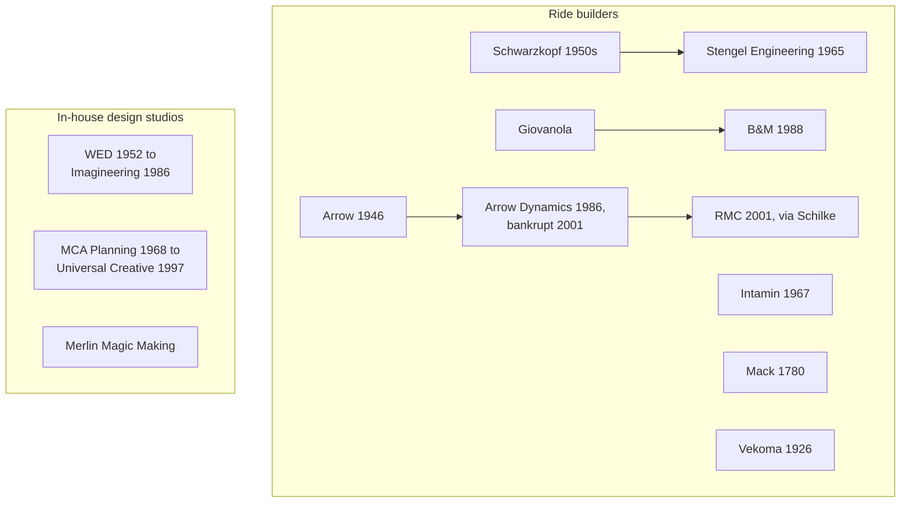

Theme park history is often told as a list of rides. This group tells it as a list of hands. The ride builders are a small world. [Arrow Dynamics](../history/arrow-dynamics.md) built the Matterhorn, the first log flume and the first hypercoaster, then went bankrupt in 2001; its alumni seeded later firms. [Schwarzkopf and Stengel](../history/schwarzkopf-and-stengel.md) gave coasters the clothoid loop and the discipline of heartlining. The [big manufacturers](../history/coaster-manufacturers.md), B&M, Intamin, Mack, Vekoma and RMC, each own a style, and engineers have moved between them for decades.

The design studios are the other half. [Legendary Imagineers](../history/legendary-imagineers.md) like Marc Davis, Mary Blair, Claude Coats, John Hench, Tony Baxter and Joe Rohde defined what a themed environment is. [Universal Creative](../history/universal-creative.md) turned a studio tour into a rival method built on screens and licensed worlds. [Merlin Magic Making](../history/merlin-magic-making.md) shows how a multi-brand operator keeps creative work in-house.

Knowing these names helps you read the [industry structure](../operations-business/industry-structure.md), and the split between [creative roles](../careers/creative-roles.md) and [engineering roles](../careers/engineering-roles.md) still follows the studio-versus-builder line drawn here.

## Explore further
- `wikipedia-arrow-dynamics` — Arrow Dynamics
- `wikipedia-werner-stengel` — Werner Stengel
- `wikipedia-walt-disney-imagineering` — Walt Disney Imagineering
- `wikipedia-universal-creative` — Universal Creative
