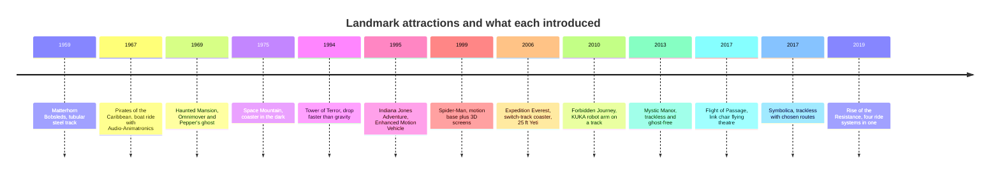

A landmark attraction is one that changed what designers thought was possible. This group is chosen for that reason, not for popularity. Each card explains the ride, then points with `example-of` relations at the concepts it demonstrates, so you can jump from a real ride to the psychology, engineering or show technology behind it.

Read them as a sequence and a pattern appears. The 1960s rides solved capacity and gaze control with boats and the Omnimover, and belong to the family of [dark rides](../ride-systems/dark-rides.md). The 1990s added motion: the Tower of Terror's cable-driven drop, Indiana Jones's bucking vehicle, Spider-Man's screens and motion base, which opened the long [screens versus sets debate](../show-technology/screens-vs-sets-debate.md). The 2010s put the vehicle itself in the story, with robot arms, trackless floors and multi-system shows, which is why [ride classification](../ride-systems/ride-classification.md) now struggles to label them.

Two threads run through all thirteen: a deliberate [ride beat sheet](../story-experience/ride-beat-sheet.md) with a peak near the end, and the goal of [lifelong ride memories](../human-factors/lifelong-ride-memories.md). Many were recognised by the TEA's Thea Awards, which have tracked this kind of achievement since 1994.

## Explore further
- `tea-thea-awards` — Thea Awards, Themed Entertainment Association
- `wikipedia-the-haunted-mansion` — The Haunted Mansion
- `wikipedia-forbidden-journey` — Harry Potter and the Forbidden Journey
- `wikipedia-rise-of-the-resistance` — Star Wars: Rise of the Resistance
