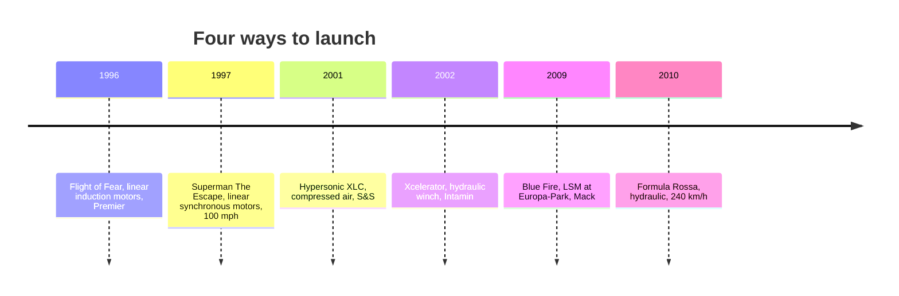

```vega-lite
{
  "$schema": "https://vega.github.io/schema/vega-lite/v5.json",
  "title": "Launch speed and time for named rides (Wikipedia)",
  "width": 300, "height": 140,
  "data": {"values": [
    {"ride": "Xcelerator 2002", "mph": 82, "s": 2.3}, {"ride": "Top Thrill Dragster 2003", "mph": 120, "s": 3.8},
    {"ride": "Kingda Ka 2005", "mph": 128, "s": 3.5}, {"ride": "Formula Rossa 2010", "mph": 149, "s": 4.9}
  ]},
  "mark": {"type": "point", "filled": true, "size": 80},
  "encoding": {
    "x": {"field": "s", "type": "quantitative", "title": "Seconds to top speed"},
    "y": {"field": "mph", "type": "quantitative", "title": "Top speed, mph"},
    "tooltip": [{"field": "ride"}]
  }
}
```

For a century a coaster began with a chain lift. On June 18, 1996 Premier Rides opened Flight of Fear at Kings Island and Kings Dominion, the first coasters launched by linear induction motors, which push a train with magnetic fields and no contact. A year later Intamin's Superman: The Escape used linear synchronous motors to reach 100 mph and 415 ft. Both are the roots of today's [LSM and LIM launches](../ride-systems/lsm-lim-launch.md).

Two other technologies had their day. S&S opened Hypersonic XLC in March 2001, the first [pneumatic launch](../ride-systems/pneumatic-launch.md), firing the train with compressed air; it ran only until 2007. Intamin's Xcelerator, opened June 22, 2002, introduced the [hydraulic launch](../ride-systems/hydraulic-launch.md), 0 to 82 mph in 2.3 seconds, and the same system powered Dragster, Kingda Ka and Formula Rossa.

Why did magnets win? Hydraulic launches are brutal on parts and on riders, with very high [jerk](../ride-engineering/jerk-and-onset-rate.md), and the specialised winches raise [spare parts and obsolescence](../operations-business/spare-parts-and-obsolescence.md) risk. LSMs are gentler, repeatable, and can fire several times in one ride, which made the modern [multi-launch coaster](../ride-systems/multi-launch-coasters.md) possible.

## Explore further
- `wikipedia-flight-of-fear` — Flight of Fear
- `wikipedia-superman-escape-from-krypton` — Superman: Escape from Krypton
- `wikipedia-hypersonic-xlc` — Hypersonic XLC
- `wikipedia-xcelerator` — Xcelerator
