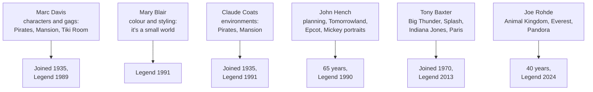

Disney's Legends list is a useful map of what Imagineers do. Marc Davis joined in 1935 as an animator, drew Maleficent and Tinker Bell, then moved to WED and supplied the characters and gags for the Tiki Room, it's a small world, Pirates, the Haunted Mansion and the Jungle Cruise. Claude Coats, a background painter from the same year, designed the environments those gags sat in; their argument over the Mansion's tone is the famous example of [cross-discipline collaboration](../design-process/cross-discipline-collaboration.md) in the trade.

Mary Blair was a colour stylist whose look defines it's a small world and the Contemporary Resort murals, the clearest case of a [colour script](../sensory-environment/color-scripts.md) driving a whole attraction. John Hench spent 65 years at Disney, shaped the original Tomorrowland, helped plan Walt Disney World, Tokyo Disneyland and Epcot, and painted Mickey's official portraits, the model for [art direction](../design-process/art-direction.md) across a company.

Tony Baxter, an Imagineer from 1970, led Big Thunder Mountain, Splash Mountain, Star Tours, Indiana Jones Adventure and Disneyland Paris, the archetypal [show producer](../design-process/show-producer.md). Joe Rohde, over four decades, created Animal Kingdom, Expedition Everest and Pandora, working from research trips and [concept art](../design-process/concept-art.md). The roles they played are the [creative roles](../careers/creative-roles.md) still hired today.

## Explore further
- `d23-legend-marc-davis` — Marc Davis, Disney Legends
- `d23-legend-mary-blair` — Mary Blair, Disney Legends
- `d23-legend-claude-coats` — Claude Coats, Disney Legends
- `d23-legend-john-hench` — John Hench, Disney Legends
