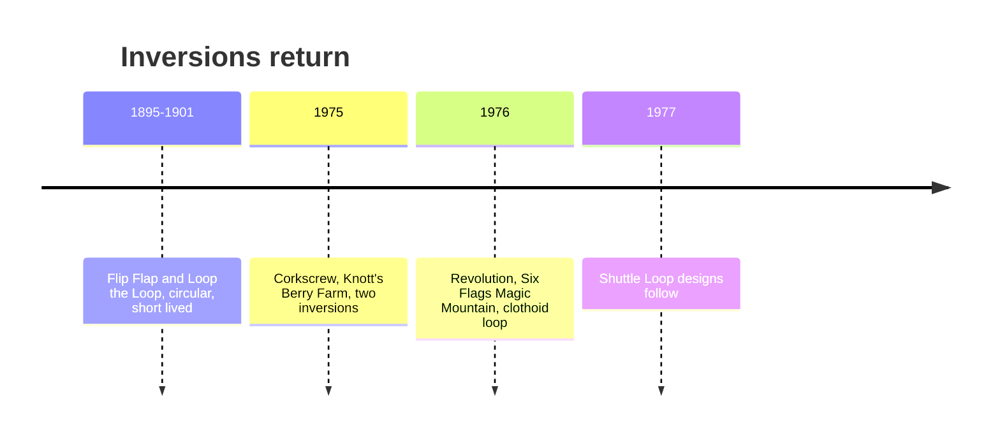

<svg viewBox="0 0 320 180" xmlns="http://www.w3.org/2000/svg" role="img" aria-label="Circular loop versus clothoid loop">
  <text x="80" y="20" text-anchor="middle" font-size="12" fill="currentColor">Circle, 1900s</text>
  <circle cx="80" cy="100" r="55" fill="none" stroke="currentColor" stroke-width="3" stroke-dasharray="6 4"/>
  <text x="80" y="172" text-anchor="middle" font-size="10" fill="currentColor">tight at the bottom, harsh g</text>
  <text x="235" y="20" text-anchor="middle" font-size="12" fill="currentColor">Clothoid, 1976</text>
  <path d="M170 160 C 170 90, 200 40, 235 40 C 270 40, 300 90, 300 160" fill="none" stroke="#4a90d9" stroke-width="3"/>
  <path d="M190 160 C 195 110, 215 60, 235 60 C 255 60, 275 110, 280 160" fill="none" stroke="#4a90d9" stroke-width="2" opacity="0.5"/>
  <text x="235" y="172" text-anchor="middle" font-size="10" fill="currentColor">wide below, tight on top</text>
</svg>

Coasters looped as early as 1895, but circular loops hit riders with brutal force at the bottom and the rides were dismantled within years. The idea lay dormant for seven decades. On May 21, 1975 Arrow's Corkscrew opened at Knott's Berry Farm and turned riders over twice; ten copies followed by 1979. A year later, on May 8, 1976, Anton Schwarzkopf and engineer Werner Stengel opened the Great American Revolution at Six Flags Magic Mountain with the first modern vertical loop.

Stengel's loop was not a circle. It was a [clothoid](../ride-engineering/clothoid-loop.md), an Euler spiral whose radius tightens toward the top and widens at the bottom. That keeps [positive g](../ride-engineering/positive-g.md) at the entry within tolerance and reduces the [jerk](../ride-engineering/jerk-and-onset-rate.md), the rate at which force comes on. Tubular steel made the shape buildable.

Once inversions were safe they multiplied into the catalogue of [track elements](../ride-engineering/track-elements.md) we take for granted, and the same geometry informs [inverting flat rides](../ride-systems/inverting-flats.md). The people behind it are covered in [Schwarzkopf and Stengel](../history/schwarzkopf-and-stengel.md).

## Explore further
- `wikipedia-corkscrew-silverwood` — Corkscrew (Knott's Berry Farm, now Silverwood)
- `wikipedia-great-american-revolution` — The Great American Revolution
- `wikipedia-werner-stengel` — Werner Stengel
- `wikipedia-history-of-the-roller-coaster` — History of the roller coaster
