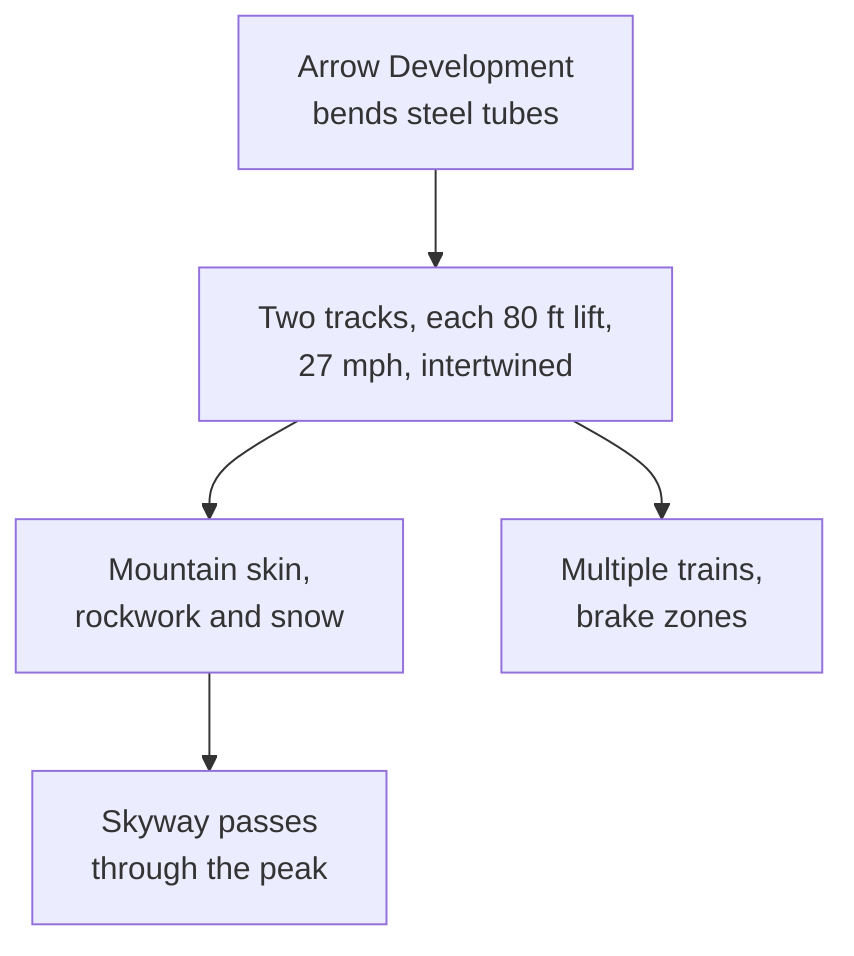

*Photo: Gene Spesard, CC BY 2.0, via Wikimedia Commons — [source](https://commons.wikimedia.org/wiki/File:Matterhorn_Bobsleds_and_Skyway_at_Disneyland.jpg)*

Matterhorn Bobsleds opened on June 14, 1959 as a one-hundredth-scale Swiss peak with a coaster inside. Arrow Development bent steel tubing into track for it, and it is credited as the first permanent tubular-steel roller coaster, though similar track had toured European fairs a few years earlier. Two tracks, Fantasyland and Tomorrowland, each with an 80 ft lift and a 27 mph top speed, weave through the mountain and split at the loading areas.

The engineering is the heart of the [tubular steel breakthrough](../history/tubular-steel-breakthrough.md). Wheels gripping a round tube on three sides make smooth, three-dimensional curves possible, a new category among [track types](../ride-engineering/track-types.md). Running several short trains at once required brake zones along the course, an early form of the [block system](../ride-engineering/block-system.md) every modern coaster uses.

The mountain is the other lesson. Its [rockwork](../design-process/rockwork.md) shrinks in scale as it rises, so [forced perspective](../story-experience/forced-perspective.md) makes it read as a real alp, and it works as a [central icon](../masterplanning/central-icon.md) visible across the park. In 1978 the original luge-style cars were replaced by coupled bobsleds, raising capacity per train to eight.

## Explore further
- `wikipedia-matterhorn-bobsleds` — Matterhorn Bobsleds
- `wikipedia-arrow-dynamics` — Arrow Dynamics
- `wikipedia-history-of-the-roller-coaster` — History of the roller coaster
