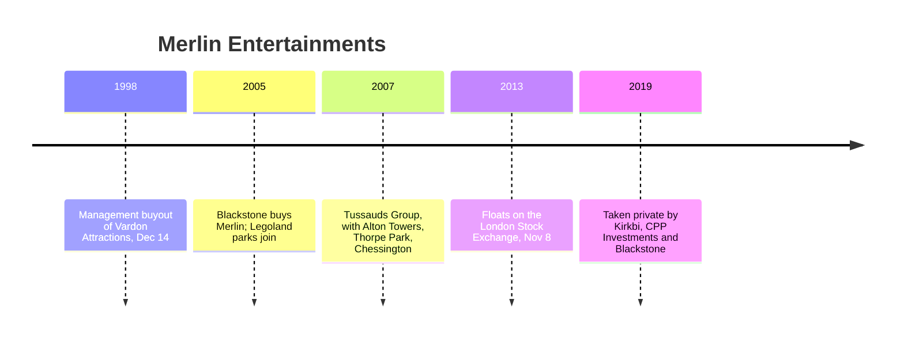

Merlin Entertainments is the counter-model to Disney and Universal: many brands, many mid-sized sites, and no film studio. It began on December 14, 1998 with a management buyout of Vardon Attractions led by Nick Varney. Under Blackstone it took control of the Legoland parks in 2005, then absorbed the Tussauds Group in 2007, which brought Alton Towers, Thorpe Park, Chessington and Madame Tussauds. It floated in London in 2013 and was taken private in 2019 by Kirkbi, the Lego family's holding company, with CPP Investments and Blackstone.

That history explains its [industry structure](../operations-business/industry-structure.md): a portfolio operator whose parks are mostly [regional rather than destination](../masterplanning/regional-vs-destination.md), and whose rides, such as Nemesis (1994) and Oblivion (1998) at Alton Towers, are often bought from outside builders at modest [capital budgets](../operations-business/capital-budgets.md). Its Lego and Tussauds brands are long-term licences, a case for [IP licensing economics](../operations-business/ip-licensing-economics.md).

Merlin Magic Making is the company's in-house creative and development team, responsible for new lands and attractions across the group. Its structure is uncertain here: Merlin's history page renders its timeline as images and no dedicated division page could be verified. In Europe it is the largest heir to the [European park tradition](../history/european-parks.md).

## Explore further
- `wikipedia-merlin-entertainments` — Merlin Entertainments
- `merlin-corporate-history` — Our History, Merlin Entertainments
- `wikipedia-alton-towers` — Alton Towers
