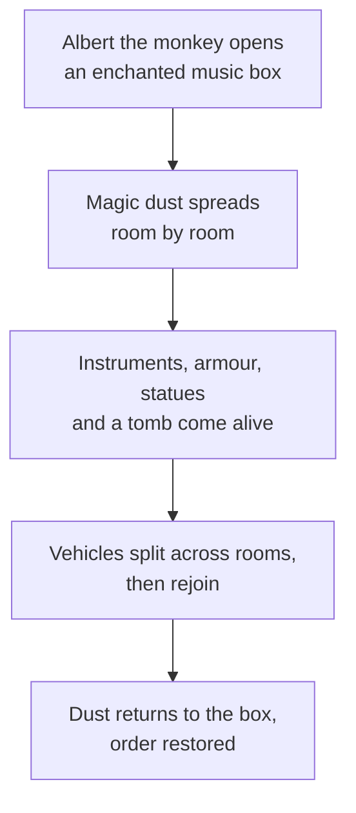

Mystic Manor opened at Hong Kong Disneyland on May 17, 2013 as the centrepiece of Mystic Point. It asks the Haunted Mansion question again for a different culture. Ghosts and the afterlife are sensitive subjects in traditional Chinese culture, so the Imagineers wrote a light fantasy instead: Lord Henry Mystic, a collector, and his monkey Albert, who opens a music box that brings the collection to life. That choice is the clearest example in any park of [cultural differences](../human-factors/cultural-differences.md) driving [localisation](../human-factors/localisation.md) of a whole attraction, and the reason the card [contrasts with the Haunted Mansion](../history/haunted-mansion.md).

The ride system is trackless, the same family as Tokyo Disneyland's Pooh's Hunny Hunt of 2000. Vehicles roam the floor, split into different rooms and regroup, which lets scenes stage action around the car rather than beside it. It remains a reference [trackless ride](../ride-systems/trackless-ride.md).

Danny Elfman's score drives the show, with musical motifs that shift as each room wakes, a strong case for an integrated [sound design pipeline](../show-technology/sound-design-pipeline.md). Suits of armour, statues and instruments that play themselves supply [kinetics in scenes](../story-experience/kinetics-in-scenes.md). The TEA gave it an award for outstanding achievement in November 2013.

## Explore further
- `wikipedia-mystic-manor` — Mystic Manor
- `wikipedia-hong-kong-disneyland` — Hong Kong Disneyland
- `wikipedia-pooh-hunny-hunt` — Pooh's Hunny Hunt
- `tea-thea-awards` — Thea Awards
