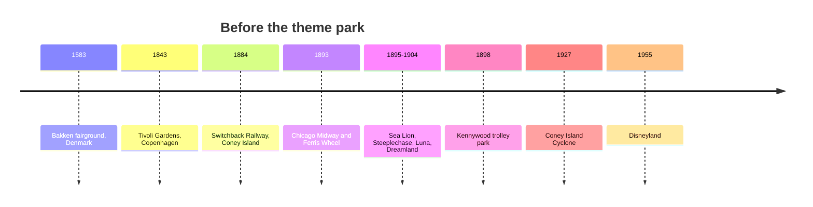

*Photo: King of Hearts, CC BY-SA 4.0, via Wikimedia Commons — [source](https://commons.wikimedia.org/wiki/File:Coney_Island_Cyclone_New_York_September_2016_001.jpg)*

The theme park did not appear from nowhere in 1955. It was assembled from older habits. Europe's [pleasure gardens and world's fairs](../history/pleasure-gardens-and-worlds-fairs.md) taught people to pay for an evening of lights, music and novelty. [Coney Island](../history/coney-island.md) turned that into a fenced park with one gate, and its showmen learned that a fantasy skyline sells tickets. [Early coasters](../history/early-coasters.md) supplied the thrill engine, from ice slides to Thompson's five-cent Switchback Railway. [Trolley parks](../history/trolley-parks.md) spread the idea across America, because streetcar firms needed weekend riders. And [Tivoli and the European roots](../history/tivoli-and-european-roots.md) kept a gentler model alive that Walt Disney admired for its cleanliness and charm.

Each ancestor left a design lesson that still matters: the single-gate enclosure, the [regional versus destination](../masterplanning/regional-vs-destination.md) trade-off, and the difference between a decorated midway and a story-driven place, the question of [theme versus decoration](../story-experience/theme-vs-decoration.md). Most early rides were [wooden coasters](../ride-systems/wooden-coasters.md), and their ride feel still shapes what guests expect from a drop today.

## Explore further
- `wikipedia-history-of-the-roller-coaster` — History of the roller coaster
- `wikipedia-coney-island` — Coney Island
- `wikipedia-tivoli-gardens` — Tivoli Gardens
- `wikipedia-trolley-park` — Trolley park
