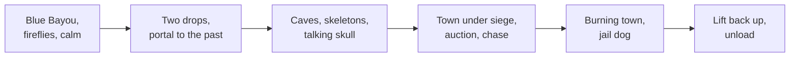

Pirates of the Caribbean opened at Disneyland on March 18, 1967, three months after Walt Disney's death, and was the last attraction he worked on. It began as a walk-through wax museum in New Orleans Square. The success of the high-capacity boats built for it's a small world at the 1964 fair changed the plan to a flume, and Arrow Development built the ride system. The result is the model [boat dark ride](../ride-systems/boat-dark-ride.md): quiet, continuous, and able to swallow a crowd.

Marc Davis drew the gags and characters; Claude Coats shaped the environments; X Atencio wrote the script and the song. The boat passes 119 or more Audio-Animatronics figures, by far the biggest use of [animatronics](../show-technology/animatronics.md) at the time. The two drops are a lesson in [thresholds and portals](../story-experience/thresholds-and-portals.md): you fall out of the present and into the past. Every room is dense with [set dressing and props](../story-experience/set-dressing-and-props.md), and the fire, cannon splashes and chases are classic [kinetics in scenes](../story-experience/kinetics-in-scenes.md).

The ride later spawned a film franchise and then absorbed its characters, a rare reverse case of [IP adaptation](../story-experience/ip-adaptation.md).

## Explore further
- `wikipedia-pirates-of-the-caribbean-attraction` — Pirates of the Caribbean (attraction)
- `d23-legend-marc-davis` — Marc Davis, Disney Legends
- `d23-legend-claude-coats` — Claude Coats, Disney Legends
- `wikipedia-its-a-small-world` — It's a Small World
