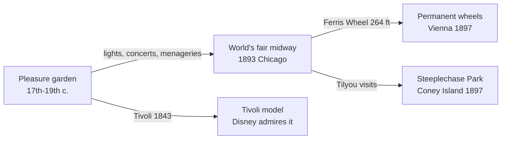

A pleasure garden was a park you paid to enter so you could stroll, eat, hear a band and watch fireworks after dark. London's public gardens began opening in the later 1600s and added concert halls, bandstands, menageries and simple rides. They proved an idea the whole industry rests on: people will pay for an atmosphere, not just a device.

World's fairs scaled that up. The 1893 Chicago exposition split its serious halls from an amusement strip, the Midway Plaisance, and gave the word "midway" to English. Its 264 ft Ferris Wheel, built to answer the Eiffel Tower, is the ancestor of every [observation wheel](../ride-systems/observation-wheel.md), including Vienna's 1897 Riesenrad. George Tilyou went home from Chicago and built Steeplechase Park, which is why the fair matters to [Coney Island](../history/coney-island.md).

Fairs also fixed two habits: a tall [central icon](../masterplanning/central-icon.md) that pulls crowds, and [night-time spectaculars](../show-technology/nighttime-spectaculars.md) that keep them late. Seventy years on, the [1964 New York World's Fair](../history/worlds-fair-1964.md) played the same role for Disney.

## Explore further
- `wikipedia-pleasure-garden` — Pleasure garden
- `wikipedia-worlds-columbian-exposition` — World's Columbian Exposition
- `wikipedia-wiener-riesenrad` — Wiener Riesenrad
