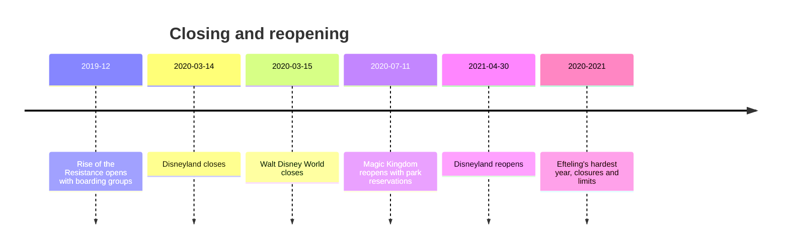

```vega-lite
{
  "$schema": "https://vega.github.io/schema/vega-lite/v5.json",
  "title": "Illustrative: a capped park shifts the queue from the turnstile to the app",
  "width": 300, "height": 140,
  "data": {"values": [
    {"stage": "Before 2020", "where": "Turnstile queue", "v": 8}, {"stage": "Before 2020", "where": "App reservation", "v": 1},
    {"stage": "After 2020", "where": "Turnstile queue", "v": 2}, {"stage": "After 2020", "where": "App reservation", "v": 8}
  ]},
  "mark": "bar",
  "encoding": {"x": {"field": "stage", "type": "nominal", "title": null}, "y": {"field": "v", "type": "quantitative", "title": "Friction, illustrative"}, "color": {"field": "where", "type": "nominal", "title": null}}
}
```

In March 2020 the industry stopped. Disneyland closed on March 14 and Walt Disney World on March 15; Florida's parks stayed shut until July 11, 2020, and Disneyland did not reopen until April 30, 2021. Efteling's own history calls 2020 the hardest year it had known. When gates reopened, capacity was capped, and a dated park reservation was required to enter, which turned the old walk-up model into a booking system.

The tools were already waiting. Rise of the Resistance had opened in December 2019 with boarding groups claimed in an app, and that [virtual queue](../human-factors/virtual-queues.md) pattern spread to whole parks. Free FastPass-style systems gave way to [paid priority access](../human-factors/paid-priority-access.md), and the park app became the place where [wait-time data](../operations-business/wait-time-data-and-apps.md) and bookings live.

The design questions are now operational and ethical as much as spatial. A reservation cap is [capacity versus demand](../operations-business/capacity-vs-demand.md) made visible to guests. Selling the shortest line raises [queue fairness](../human-factors/queue-fairness.md) questions, and dated, variable tickets changed [pricing](../operations-business/pricing.md). Historians will likely mark 2020 as the end of the spontaneous park visit.

## Explore further
- `wikipedia-walt-disney-world` — Walt Disney World
- `wikipedia-disneyland` — Disneyland
- `wikipedia-rise-of-the-resistance` — Star Wars: Rise of the Resistance
- `efteling-official-history` — History of Efteling (official)
