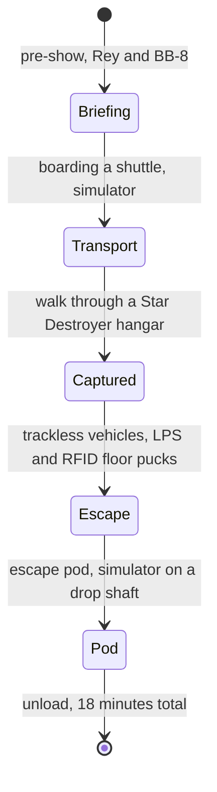

Star Wars: Rise of the Resistance opened at Disney's Hollywood Studios on December 5, 2019 and at Disneyland on January 17, 2020. It is described as a multi-modal, multi-phase attraction: a sequence of pre-shows, a motion-simulator shuttle, a walk through a hangar lined with stormtroopers, a trackless chase, and a final escape pod that is a simulator on a concealed drop shaft. The whole thing runs about 18 minutes.

Each piece is a known system; the landmark is the chaining. The [trackless vehicles](../ride-systems/trackless-ride.md) navigate with a local positioning system and RFID pucks in the floor, so they can split, pause and reverse. Keeping shuttles, doors, vehicles and the drop in step needs unusually complex [show control systems](../show-technology/show-control-systems.md), and the attraction follows a clear [three-act structure](../story-experience/three-act-ride.md) with the [pre-shows](../story-experience/pre-show.md) carrying real plot.

It is also an operations landmark. Because capacity is low for its demand, Disney opened it with boarding groups instead of FastPass: guests joined a [virtual queue](../human-factors/virtual-queues.md) in the app, and groups filled within minutes of park opening. Early reliability was uneven, which made it a public case study in [downtime and availability](../operations-business/downtime-and-availability.md).

## Explore further
- `wikipedia-rise-of-the-resistance` — Star Wars: Rise of the Resistance
- `wikipedia-disneys-hollywood-studios` — Disney's Hollywood Studios
