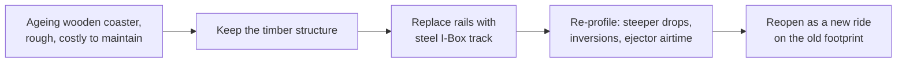

<svg viewBox="0 0 320 180" xmlns="http://www.w3.org/2000/svg" role="img" aria-label="Wooden track versus I-Box track cross-section">
  <text x="80" y="20" text-anchor="middle" font-size="12" fill="currentColor">Wood: laminated stack</text>
  <rect x="40" y="60" width="80" height="12" fill="#b07a3b"/>
  <rect x="40" y="74" width="80" height="12" fill="#b07a3b" opacity="0.8"/>
  <rect x="40" y="88" width="80" height="12" fill="#b07a3b" opacity="0.6"/>
  <rect x="40" y="54" width="80" height="5" fill="currentColor"/>
  <text x="80" y="130" text-anchor="middle" font-size="10" fill="currentColor">steel strap on timber</text>
  <text x="240" y="20" text-anchor="middle" font-size="12" fill="currentColor">I-Box: steel I-beam</text>
  <rect x="200" y="52" width="80" height="10" fill="#4a90d9"/>
  <rect x="232" y="62" width="16" height="36" fill="#4a90d9"/>
  <rect x="200" y="98" width="80" height="10" fill="#4a90d9"/>
  <rect x="200" y="112" width="80" height="12" fill="#b07a3b" opacity="0.6"/>
  <text x="240" y="140" text-anchor="middle" font-size="10" fill="currentColor">bolted to the old wooden ledgers</text>
</svg>

Rocky Mountain Construction, founded in Idaho in 2001 by Fred Grubb, was a wooden coaster repair firm. With designer Alan Schilke it developed I-Box track, a steel I-beam rail that bolts onto an existing timber structure. The first conversion, Texas Giant at Six Flags Over Texas, reopened as New Texas Giant on April 22, 2011 with steeper drops and overbanked turns the wood could never have carried.

The idea fixed a lifecycle problem. Big wooden coasters shake themselves apart and cost a fortune to re-track, the classic late stage of a [ride lifecycle](../operations-business/ride-lifecycle.md). RMC's [hybrid coasters](../ride-systems/hybrid-coasters.md) keep the structure, the footprint and often the name, and get a new profile with [heartline](../ride-engineering/heartline.md) inversions and sharp ejector [airtime](../ride-engineering/airtime-and-negative-g.md). It reframes the old [wood versus steel](../ride-engineering/wood-vs-steel.md) argument as wood and steel.

The era's peak is Steel Vengeance at Cedar Point, opened May 5, 2018 on the bones of Mean Streak: 205 ft, four inversions, and marketed as the first hyper-hybrid. The era also carries a warning. In July 2013 a rider died on New Texas Giant; the park said there was no mechanical failure, but the ride returned with redesigned restraints, seat belts and pads, a case studied under [restraint design rules](../safety-standards/restraint-design-rules.md).

## Explore further
- `wikipedia-rocky-mountain-construction` — Rocky Mountain Construction
- `wikipedia-new-texas-giant` — New Texas Giant
- `wikipedia-steel-vengeance` — Steel Vengeance
