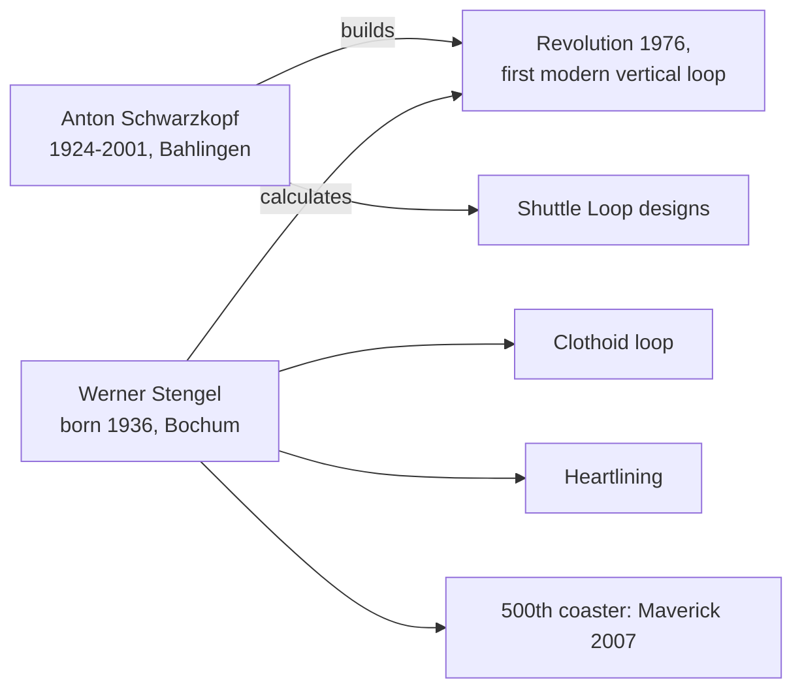

> **Formula** $a_c = \dfrac{v^2}{r}$
> where:
> - $a_c$ is the centripetal acceleration the rider feels pressing them into the seat
> - $v$ is the train's speed at that point of the loop
> - $r$ is the local radius of the track; a clothoid grows $r$ at the fast bottom and shrinks it at the slow top so $a_c$ stays even

Anton Schwarzkopf, born in 1924, built fairground rides in southern Germany and became the leading coaster maker of the 1960s and 1970s. Werner Stengel, born in 1936, founded Stengel Engineering in Munich in 1965 and did the calculations behind Schwarzkopf's rides. Their landmark is the Great American Revolution at Six Flags Magic Mountain, opened May 8, 1976, the first modern vertical loop.

Stengel's loop was a [clothoid](../ride-engineering/clothoid-loop.md). The physics is in the formula: force depends on speed squared over radius, so a loop that is wide where the train is fast and tight where it is slow keeps the force steady. He also pioneered heartlining, making the track twist around the rider's [heart line](../ride-engineering/heartline.md) rather than its own centre, and the smooth [spline transitions](../ride-engineering/spline-transitions.md) that separate a good steel coaster from a rough one. Schwarzkopf's [shuttle loop](../ride-systems/shuttle-coasters.md) designs, from 1977, were another signature.

Schwarzkopf's firm went bankrupt in 1983 and he died in 2001. Stengel's office went on to design Millennium Force, Kingda Ka, El Toro and Maverick, its 500th coaster, and still offers ride design, steel construction and [fatigue](../ride-engineering/fatigue.md) analysis. For anyone weighing [engineering roles](../careers/engineering-roles.md), the pairing is the model: a builder and an analyst who trusted each other.

## Explore further
- `wikipedia-anton-schwarzkopf` — Anton Schwarzkopf
- `wikipedia-werner-stengel` — Werner Stengel
- `stengel-engineering-site` — IB Stengel GmbH
- `wikipedia-great-american-revolution` — The Great American Revolution
