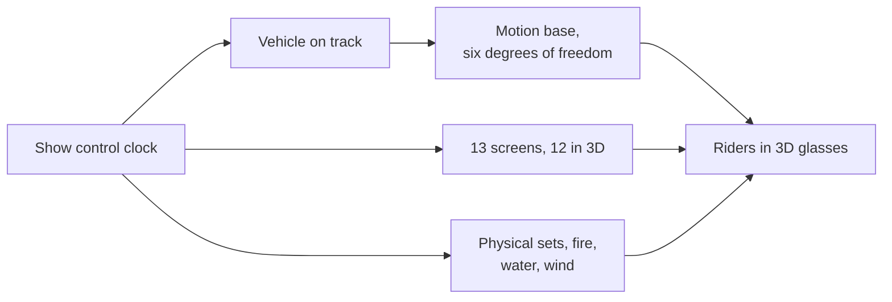

```vega-lite
{
  "$schema": "https://vega.github.io/schema/vega-lite/v5.json",
  "title": "Islands of Adventure attendance around the Spider-Man era, millions (Wikipedia)",
  "width": 300, "height": 130,
  "data": {"values": [{"year": "2009", "m": 4.63}, {"year": "2010", "m": 5.95}, {"year": "2011", "m": 7.67}]},
  "mark": "bar",
  "encoding": {"x": {"field": "year", "type": "nominal", "title": null}, "y": {"field": "m", "type": "quantitative", "title": "Guests, millions"}}
}
```

The Amazing Adventures of Spider-Man opened with Islands of Adventure on May 28, 1999. Universal Creative mounted a motion base on a tracked vehicle and drove it past 13 screens, 12 of them 3D, mixed with physical sets, fire and water. The vehicle's tilt and the film's camera move together, so a projected fall feels like a fall. It won a Thea Award in 2000 and was remastered in high definition in 2012. It is the reference [media dark ride](../ride-systems/media-dark-ride.md).

Transformers: The Ride 3D, opened in Singapore on December 3, 2011, Hollywood in 2012 and Orlando in 2013, refined the same recipe. Oceaneering built vehicles with a yaw motor and a six-axis [Stewart platform](../ride-systems/stewart-platform.md), and Industrial Light & Magic produced the media. Both rides depend on tight [ride-show synchronisation](../show-technology/ride-show-synchronization.md) between the [motion base](../ride-systems/motion-base.md), the [stereoscopic 3D](../show-technology/stereoscopic-3d.md) frames and set effects.

Their success also started an argument that has not ended: the [screens versus sets debate](../show-technology/screens-vs-sets-debate.md). Screens update cheaply and stage impossible action; sets age well and feel real. Most later Universal rides are answers to that question.

## Explore further
- `wikipedia-amazing-adventures-of-spider-man` — The Amazing Adventures of Spider-Man
- `wikipedia-transformers-the-ride` — Transformers: The Ride 3D
- `wikipedia-universal-creative` — Universal Creative
- `tea-thea-awards` — Thea Awards
