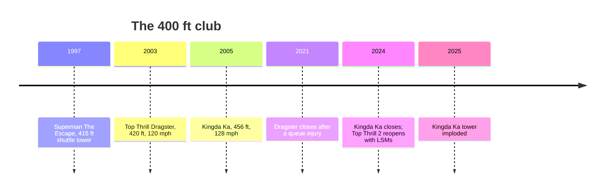

*Photo: Dusso Janladde, CC BY-SA 3.0, via Wikimedia Commons — [source](https://commons.wikimedia.org/wiki/File:Kingda_Ka.jpg)*

A strata coaster is a full-circuit coaster 400 to 499 ft tall; Intamin built both. Top Thrill Dragster opened at Cedar Point on May 4, 2003: a hydraulic launch to 120 mph in 3.8 seconds, up a 420 ft top hat and down. Kingda Ka followed at Six Flags Great Adventure on May 21, 2005 at 456 ft and 128 mph, and held the height record until it closed.

The engineering lives on the edge. A [hydraulic launch](../ride-systems/hydraulic-launch.md) stores energy in accumulators and releases it through a cable winch; a short launch leaves the train rolling back down the tower, which is why [anti-rollback](../ride-engineering/anti-rollback.md) brakes line the launch track. Loads at this speed make [fatigue](../ride-engineering/fatigue.md) the limiting design case, and a tower this tall moves visibly with [thermal expansion](../ride-engineering/thermal-expansion.md).

Both rides also show the costs. In August 2021 a part fell from a Dragster train and seriously hurt a guest in the queue, a case in [lessons from incidents](../safety-standards/lessons-from-incidents.md). Zamperla rebuilt it as Top Thrill 2 with LSM launches in 2024. Kingda Ka closed on November 10, 2024 and its tower was imploded on February 28, 2025, a dramatic example of [retirement and relocation](../operations-business/retirement-and-relocation.md).

## Explore further
- `wikipedia-top-thrill-dragster` — Top Thrill Dragster
- `wikipedia-kingda-ka` — Kingda Ka
- `wikipedia-intamin` — Intamin
- `wikipedia-superman-escape-from-krypton` — Superman: Escape from Krypton
