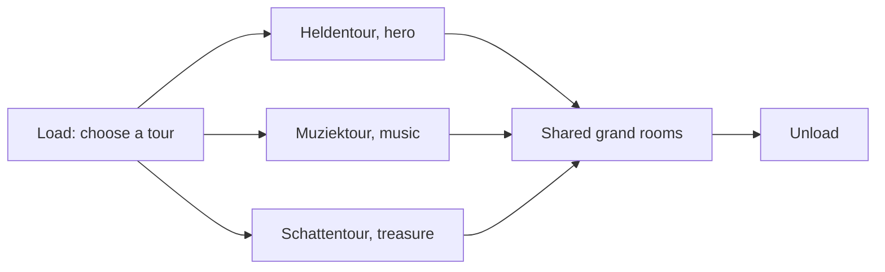

*Photo: Eliedion, CC BY-SA 4.0, via Wikimedia Commons — [source](https://commons.wikimedia.org/wiki/File:Symbolica_Palace_Efteling.jpg)*

Symbolica: Palace of Fantasy opened on July 1, 2017 for Efteling's 65th year. At about EUR 35 million it tied Danse Macabre as the park's most expensive project, a scale of [capital budget](../operations-business/capital-budgets.md) unusual for a single European dark ride. Pardoes the jester, the park mascot, sneaks guests into the king's palace through hidden passages.

The ride system, by ETF Ride Systems, is trackless, and Efteling used that freedom in a way Disney had not: before boarding, each group picks one of three tours, Hero, Music or Treasure. Cars then follow different paths through the same building, sharing the grand rooms and splitting for private ones. It is a [trackless ride](../ride-systems/trackless-ride.md) used as [choice architecture](../human-factors/choice-architecture.md), giving guests a small, legible decision that changes the ride and invites a repeat.

That makes it a key case in the [agency versus spectacle](../human-factors/agency-vs-spectacle.md) debate and a gentle form of [interactive dark ride](../ride-systems/interactive-dark-ride.md), where the choice itself is the interaction. It also shows the [European park tradition](../history/european-parks.md) at full confidence: an original story, a mascot, and a palace that fits a fairy-tale park rather than a film.

## Explore further
- `wikipedia-symbolica` — Symbolica
- `efteling-official-history` — History of Efteling (official)
