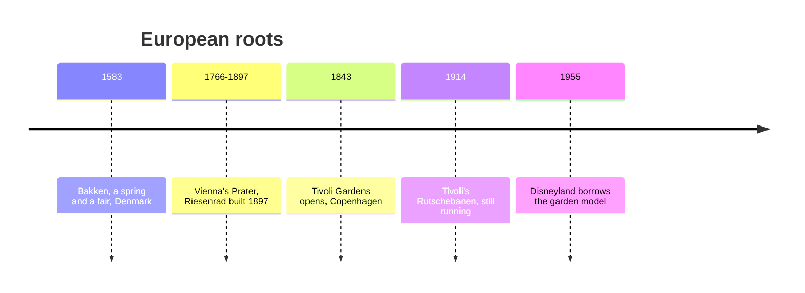

*Photo: Leif Jørgensen, CC BY-SA 4.0, via Wikimedia Commons — [source](https://commons.wikimedia.org/wiki/File:Tivoli_at_night_-_Rutschebanen.JPG)*

Europe never lost the pleasure garden. Bakken, north of Copenhagen, dates its crowds to a spring found in 1583 and is recognised as the oldest operating amusement park. Vienna's Prater added the 64.75 m Riesenrad in 1897. And in 1843 Georg Carstensen opened Tivoli Gardens in the centre of Copenhagen: a lake, lanterns, bandstands, restaurants and a few rides, including a 1914 wooden coaster with a brakeman still aboard.

Walt Disney is described as heavily influenced by Tivoli's cleanliness and layout when planning Disneyland. The connection is not about rides. Tivoli shows how [planting design](../sensory-environment/planting-design.md) and evening [lighting mood](../sensory-environment/lighting-mood.md) can make a small site feel generous, and how [scale and intimacy](../story-experience/scale-and-intimacy.md) keep a park pleasant for adults, not just children.

That garden-first instinct remains the signature of the [European park tradition](../history/european-parks.md), from Efteling's fairytale wood to Europa-Park's village squares. When [Disneyland](../history/disneyland-1955.md) opened in 1955, it fused this model with Hollywood storytelling and Coney Island's single gate.

## Explore further
- `wikipedia-tivoli-gardens` — Tivoli Gardens
- `wikipedia-dyrehavsbakken` — Dyrehavsbakken (Bakken)
- `wikipedia-wiener-riesenrad` — Wiener Riesenrad
- `wikipedia-walt-disney` — Walt Disney
