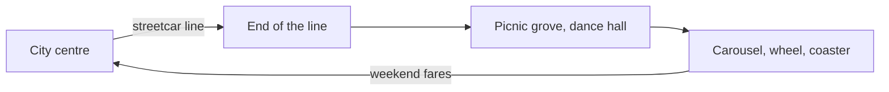

```vega-lite
{
  "$schema": "https://vega.github.io/schema/vega-lite/v5.json",
  "title": "Illustrative: why a park at the end of the line paid for itself",
  "width": 300, "height": 140,
  "data": {"values": [
    {"day": "Mon", "riders": 100}, {"day": "Tue", "riders": 100}, {"day": "Wed", "riders": 100},
    {"day": "Thu", "riders": 100}, {"day": "Fri", "riders": 105}, {"day": "Sat", "riders": 40}, {"day": "Sun", "riders": 25}
  ]},
  "mark": "bar",
  "encoding": {
    "x": {"field": "day", "type": "nominal", "sort": null, "title": "Weekday commuting leaves weekend cars empty"},
    "y": {"field": "riders", "type": "quantitative", "title": "Riders, index"}
  }
}
```



A trolley park solved a business problem, not an entertainment one. Streetcar companies paid a flat rate for electricity and ran full cars on weekdays and empty ones on weekends. So they built picnic groves, pavilions and dance halls at the end of the line, then added carousels, wheels and coasters. The park existed to sell the ride there and back.

Kennywood, opened by the Monongahela Street Railway outside Pittsburgh in 1898, is the classic survivor; its Jack Rabbit coaster of 1920 still runs. Sources cited on the topic count 1,500 to 2,000 American amusement parks by 1919, many of them trolley parks, before cars, the Depression and suburbs thinned them out.

For designers the model is worth studying. It is an early answer to [site selection](../masterplanning/site-selection.md) and [parking and transit](../masterplanning/parking-and-transit.md): put the park where the transport already goes. It is also a lesson in [seasonality and events](../operations-business/seasonality-and-events.md), since the whole business lived on summer weekends. The parks served their own city, the pattern we now call [regional rather than destination](../masterplanning/regional-vs-destination.md), and they were the main customers for the 1920s boom in [wooden coasters](../ride-systems/wooden-coasters.md).

## Explore further
- `wikipedia-trolley-park` — Trolley park
- `wikipedia-kennywood` — Kennywood
- `wikipedia-cedar-point` — Cedar Point
