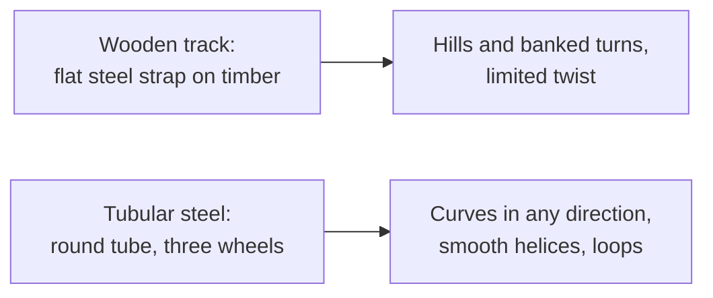

<svg viewBox="0 0 320 180" xmlns="http://www.w3.org/2000/svg" role="img" aria-label="Cross-section of tubular steel track with three wheels">
  <rect width="320" height="180" fill="none"/>
  <text x="160" y="20" text-anchor="middle" font-size="12" fill="currentColor">Tubular track cross-section, three wheel sets</text>
  <circle cx="160" cy="105" r="28" fill="none" stroke="currentColor" stroke-width="3"/>
  <text x="160" y="109" text-anchor="middle" font-size="11" fill="currentColor">rail</text>
  <rect x="140" y="52" width="40" height="22" rx="6" fill="#4a90d9" opacity="0.8"/>
  <text x="160" y="46" text-anchor="middle" font-size="10" fill="currentColor">road wheel</text>
  <rect x="92" y="94" width="40" height="22" rx="6" fill="#e8a33d" opacity="0.8"/>
  <text x="70" y="88" text-anchor="middle" font-size="10" fill="currentColor">side wheel</text>
  <rect x="140" y="136" width="40" height="22" rx="6" fill="#c0504d" opacity="0.8"/>
  <text x="160" y="172" text-anchor="middle" font-size="10" fill="currentColor">upstop wheel</text>
  <line x1="188" y1="105" x2="250" y2="105" stroke="currentColor" stroke-width="2"/>
  <text x="256" y="109" font-size="10" fill="currentColor">tie to spine</text>
</svg>

Before 1959 a coaster rail was a flat steel strap nailed to layers of wood. Cars could go up, down and round, but not twist smoothly, and the ride was rough. For the Matterhorn, Arrow Development bent round steel tubes into track and ran cars on three sets of wheels: on top, on the side and underneath. Each wheel set keeps contact as the tube rolls through a curve, so the track can bank, twist and dive in a single continuous line.

That is the whole breakthrough, and it shows up today in every [steel coaster](../ride-systems/steel-coasters.md). Designers gained a new family of [track types](../ride-engineering/track-types.md) they could shape with maths rather than carpentry. The three-wheel arrangement became the standard [wheel and bogie](../ride-engineering/wheels-and-bogies.md) layout. And because tube track could be made as a smooth curve, it opened the door to the clothoid loop of 1976 and the [loop revival](../history/loop-revival.md).

The Matterhorn's claim is usually stated carefully: the first permanent tubular-steel coaster, since similar track had toured European fairs a few years earlier. The trade-offs between the two materials, feel, cost, maintenance and sound, are covered in [wood versus steel](../ride-engineering/wood-vs-steel.md). See the ride itself at [Matterhorn Bobsleds](../history/matterhorn-bobsleds.md).

## Explore further
- `wikipedia-matterhorn-bobsleds` — Matterhorn Bobsleds
- `wikipedia-arrow-dynamics` — Arrow Dynamics
- `wikipedia-history-of-the-roller-coaster` — History of the roller coaster
