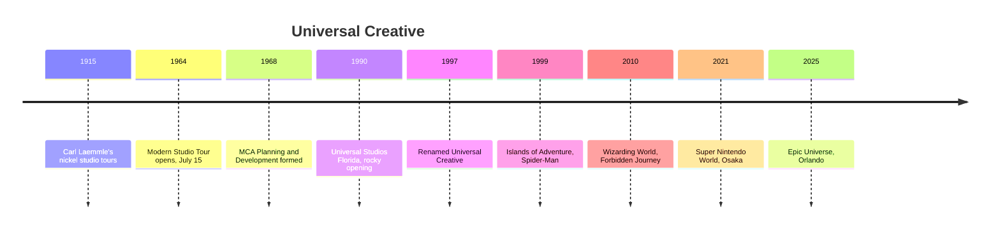

Universal's parks began as a way to show off a film studio. Carl Laemmle let the public watch filming for a nickel in 1915, and the modern Studio Tour opened on July 15, 1964. In 1968 MCA formed a planning and development group to design attractions; it was renamed Universal Creative in 1997 and is now the design and engineering division of Universal Destinations & Experiences, working in Orlando, Hollywood, Osaka, Singapore and Beijing.

Its method is different from Imagineering's. Universal Studios Florida opened on June 7, 1990 with Jaws, Kongfrontation and Earthquake all failing on day one, a hard lesson in [testing and commissioning](../design-process/testing-and-commissioning.md). The response was a run of technically bold rides: The Amazing Adventures of Spider-Man in 1999, a motion base in front of 3D screens that defined the [media dark ride](../ride-systems/media-dark-ride.md); Forbidden Journey in 2010, which made the [robot arm ride](../ride-systems/robot-arm-ride.md) mainstream; Transformers, Hagrid's Motorbike Adventure and VelociCoaster.

The studio's other signature is licensed worlds. Harry Potter, Nintendo and Jurassic Park are [IP adaptations](../story-experience/ip-adaptation.md) built with outside creators, and they fuel the [IP wars](../history/ip-wars.md) with Disney. Its heavy use of screens keeps the [screens versus sets debate](../show-technology/screens-vs-sets-debate.md) alive.

## Explore further
- `wikipedia-universal-creative` — Universal Creative
- `wikipedia-universal-studios-hollywood` — Universal Studios Hollywood
- `wikipedia-universal-studios-florida` — Universal Studios Florida
- `wikipedia-amazing-adventures-of-spider-man` — The Amazing Adventures of Spider-Man
