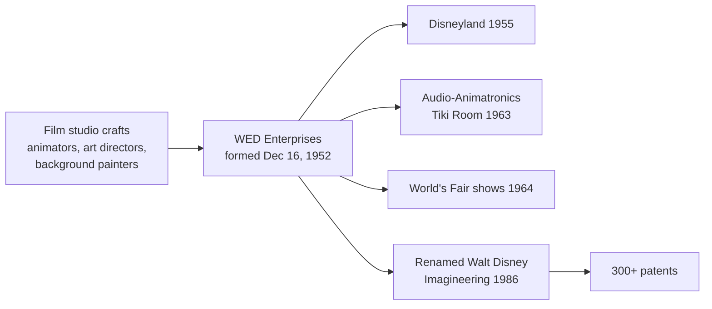

On December 16, 1952 Walt Disney set up a private company, soon renamed WED Enterprises from his initials, to design the park his studio's board would not fund. Instead of hiring architects he borrowed film people: animators, art directors and background painters who already knew how to stage a scene for an audience. That mix is the origin of the [creative roles](../careers/creative-roles.md) in the industry today and of its habit of [cross-discipline collaboration](../design-process/cross-discipline-collaboration.md).

The word Imagineering, claimed in use from 1962, named the method: imagination plus engineering. The team's early inventions include Audio-Animatronics, first shown in the Enchanted Tiki Room on June 23, 1963, the start of the long [Audio-Animatronics history](../show-technology/audio-animatronics-history.md). Walt died on December 15, 1966, before Pirates opened, and WED carried on under his brother Roy.

Renamed Walt Disney Imagineering in January 1986, the group holds over 300 patents in ride systems, audio, fibre optics and effects. Its culture of unconstrained [blue-sky](../design-process/blue-sky.md) sessions, followed by hard engineering, is still the template most studios copy. The people are covered in [Legendary Imagineers](../history/legendary-imagineers.md).

## Explore further
- `wikipedia-walt-disney-imagineering` — Walt Disney Imagineering
- `wikipedia-walt-disney` — Walt Disney
- `wikipedia-enchanted-tiki-room` — Walt Disney's Enchanted Tiki Room
- `wdfm-walt-disney-family-museum` — The Walt Disney Family Museum
