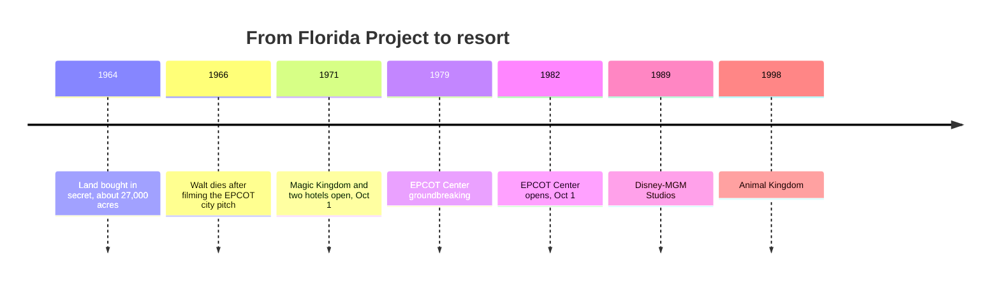

*Photo: Benjamin D. Esham (bdesham), CC BY-SA 4.0, via Wikimedia Commons — [source](https://commons.wikimedia.org/wiki/File:Spaceship_Earth_at_night.jpg)*

Disneyland was hemmed in by motels, so for Florida Disney bought roughly 27,000 acres through dummy companies before anyone knew the buyer. Walt died in December 1966; Roy O. Disney delayed retirement to finish the first phase and named it Walt Disney World at the October 1, 1971 dedication. The [site selection](../masterplanning/site-selection.md) lesson is simple: own the land and you own the view, the hotels and the growth.

The Magic Kingdom sits on top of utilidors, service corridors built at ground level because of the high water table, with the park raised above them. They keep deliveries, waste and costume changes out of sight, the clearest built example of [utilidors](../masterplanning/utilidors.md) and of [resort integration](../masterplanning/resort-integration.md), with hotels and a monorail planned from day one.

Walt's EPCOT was meant to be a working city of about 20,000 people with a central core, rings of housing and underground traffic, an idea studied in [urban planning parallels](../masterplanning/urban-planning-parallels.md). The company chose not to run a city. EPCOT Center opened on October 1, 1982 as a park of sponsored Future World pavilions and a World Showcase, with the Omnimover-driven Spaceship Earth as its icon. The gated, phased build-out is a textbook case of [expansion and phasing](../masterplanning/expansion-and-phasing.md).

## Explore further
- `wikipedia-walt-disney-world` — Walt Disney World
- `wikipedia-epcot` — Epcot
- `wikipedia-omnimover` — Omnimover
