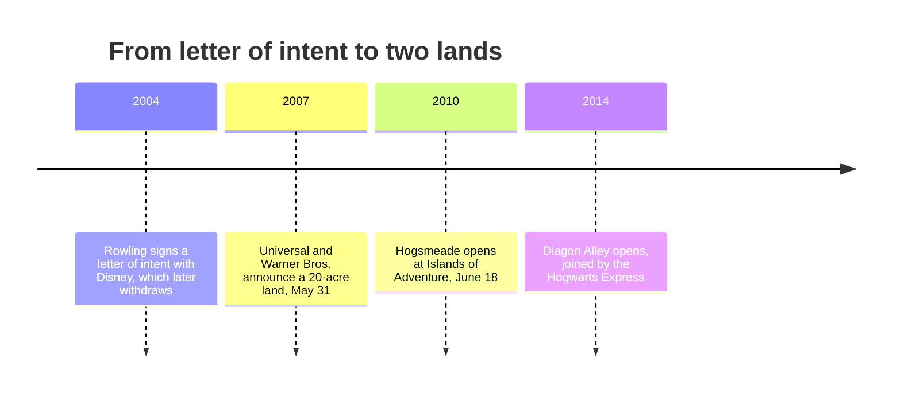

```vega-lite
{
  "$schema": "https://vega.github.io/schema/vega-lite/v5.json",
  "title": "Islands of Adventure guests, millions (TEA/AECOM via Wikipedia); Hogsmeade opened June 2010",
  "width": 320, "height": 150,
  "data": {"values": [{"year": "2008", "m": 5.29}, {"year": "2009", "m": 4.63}, {"year": "2010", "m": 5.95}, {"year": "2011", "m": 7.67}, {"year": "2012", "m": 7.98}, {"year": "2013", "m": 8.14}]},
  "mark": {"type": "bar"},
  "encoding": {"x": {"field": "year", "type": "nominal", "title": null}, "y": {"field": "m", "type": "quantitative", "title": "Guests, millions"}}
}
```



The Wizarding World is the case that convinced the industry a whole land can be the attraction. In 2004 J.K. Rowling signed a letter of intent with Disney for an area at the Magic Kingdom. Disney withdrew, saying her creative control and Warner Bros.' terms were too strict; some historians think Disney's pitch simply failed to impress her. Universal announced its own licensed land on May 31, 2007.

The licence, filed with the SEC, ran nine years with two five-year options and could be withdrawn if Universal let quality slip: [IP licensing economics](../operations-business/ip-licensing-economics.md) written as a quality guarantee. Universal sought Rowling's approval even for the Butterbeer recipe, and a wand at Ollivanders is chosen for you in a small show, an early case of [retail as attraction](../operations-business/retail-as-attraction.md).

Hogsmeade opened on June 18, 2010. Attendance rose 29% that year and about two-thirds by 2011, the standard input for [attendance modelling](../operations-business/roi-and-attendance-modeling.md). Diagon Alley followed in 2014, joined to Hogsmeade by a train that needs a two-park ticket. Its centrepiece ride is [Forbidden Journey](../history/forbidden-journey.md); the craft is [total-immersion land design](../story-experience/immersive-lands.md).

## Explore further
- `wikipedia-wizarding-world-orlando` — The Wizarding World of Harry Potter (Universal Orlando)
- `wikipedia-islands-of-adventure` — Universal Islands of Adventure
- `cbsnews-wizarding-world-opens-2010` — Harry Potter Theme Park Opens to Eager Muggles
- `wendover-how-to-design-a-theme-park` — How to Design a Theme Park (To Take Tons of Your Money)
