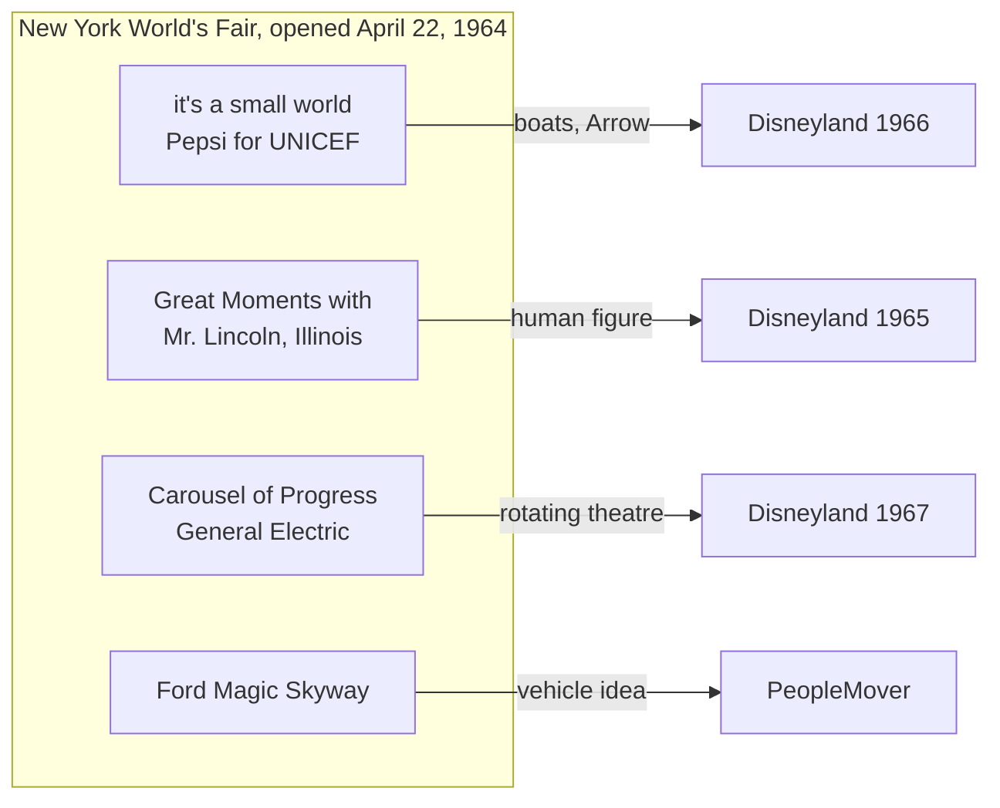

The fair opened on April 22, 1964 and gave Walt Disney something Disneyland could not: other people's money for research. Pepsi paid for it's a small world, a UNICEF tribute styled by Mary Blair with a song by the Sherman Brothers. Illinois paid for Great Moments with Mr. Lincoln, an Audio-Animatronics figure of a standing, speaking human. General Electric paid for the Carousel of Progress, a theatre where the audience rotates between stages. Ford funded the Magic Skyway.

Each show tested something. Small world's high-capacity boats, built with Arrow Development, became the [boat dark ride](../ride-systems/boat-dark-ride.md) system that carried Pirates of the Caribbean three years later, a key step in the [Audio-Animatronics history](../show-technology/audio-animatronics-history.md). The rotating theatre solved [throughput math](../operations-business/throughput-math.md) for a seated show without a queue between acts.

The business lesson is as important as the technology. Sponsorship moved the [capital budget](../operations-business/capital-budgets.md) off Disney's books, then the shows moved to Disneyland in 1965, 1966 and 1967. It is the ancestor of today's sponsored pavilions and of [IP licensing economics](../operations-business/ip-licensing-economics.md), and it set up [Pirates of the Caribbean](../history/pirates-of-the-caribbean.md).

## Explore further
- `wikipedia-1964-worlds-fair` — 1964 New York World's Fair
- `wikipedia-its-a-small-world` — It's a Small World
- `wikipedia-carousel-of-progress` — Walt Disney's Carousel of Progress
- `wikipedia-great-moments-with-mr-lincoln` — Great Moments with Mr. Lincoln
